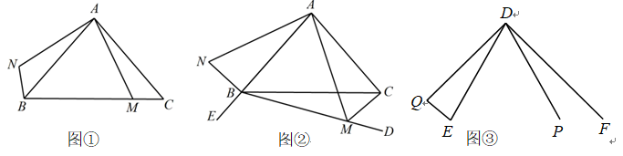

# Mathematics - 题目 2471

**ID**: 9f4224c81d804f02a034ac6873cbddf9
**年级**: Grade 9
**难度**: Hard
**题型**: Calculation

## 题目
在 $\vartriangle ABC$ 中，AB＝AC，M是平面内任意一点，将线段AM绕点A按顺时针方向旋转与∠BAC相等的角度，得到线段AN，连结NB．〖感知〗如图①，若M是线段BC上的任意一点，易证 $△ABN≌△ACM$ ，可知∠NAB＝∠MAC，BN＝MC．〖探究〗（1）如图②，点E是AB延长线上的点，若点M是∠CBE内部射线BD上任意一点，连结MC，〖感知〗中的结论是否仍然成立？若成立，请给予证明，若不成立，请说明理由．〖拓展〗（2）如图③，在 $\vartriangle DEF$ 中，DE＝8，∠DEF＝60°，∠EDF＝75°，P是EF上的任意点，连结DP，将DP绕点D按顺时针方向旋转75°，得到线段DQ，连结EQ，则EQ的最小值为．​​​​​​​‌

## 解答

1. (1)结论仍然成立．
2. 
3. 理由： $\because \angle MAN=\angle CAB$ ，
4. $\mathbf{∴}\angle NAB+\angle BAM=\angle BAM+\angle MAC$ ，
5. $\mathbf{∴}\angle NAB=\angle MAC$ ，
6. $\because AB=AC$ ， $AN=AM$ ，
7. $\therefore ΔNAB\cong ΔMAC(SAS)$ ，
8. $\therefore BN=CM$ ．
9. （2 $)$ 如图3中，在 $DF$ 上截取 $DN=DE$ ，连接 $PN$ ，作 $NH\bot EF$ 于 $H$ ，作 $DM\bot EF$ 于 $M$ ．
10. 
11. $\because \angle FDE=\angle PDQ$ ，
12. $\therefore \angle QDE=\angle PDN$ ，
13. $\because DQ=DP$ ， $DE=DN$ ，
14. $\therefore $  $\vartriangle QDE\cong \vartriangle PDN(SAS)$ ，
15. $\therefore EQ=PN$ ，
16. $\therefore $ 当 $PN$ 的值最小时， $QE$ 的值最小，
17. 在 $Rt$  $\mathrm{△}DEM$ 中，
18. $\because \angle DEM=60{}^\circ $ ， $DE=8$ ，
19. $\therefore DM=DE\centerdot {\sin}60{}^\circ =4\sqrt {3}$ ，
20. $\because \angle MDF=\angle EDF-\angle EDM=75{}^\circ -30{}^\circ =45{}^\circ $ ，
21. $\therefore DF=4\sqrt {6}$ ，
22. $\therefore NF=DF-DN=4\sqrt {6}-8$ ，
23. 在 ${\rm{R}}{\rm{t}}Δ{\rm{N}}{\rm{H}}{\rm{F}}$ ， $\because \angle F=45{}^\circ $ ，
24. $\therefore NH=4\sqrt {3}-4\sqrt {2}$ ，
25. 根据垂线段最短可知，当点 $P$ 与 $H$ 重合时， $PN$ 的值最小，
26. $\therefore QE$ 的最小值为 $4\sqrt {3}-4\sqrt {2}$ ．

## 知识点

**中文**:
  - 全等三角形的综合问题
  - 垂线段最短
  - 等腰三角形的性质
  - 旋转的性质
  - 解直角三角形的实际应用

**English**:
  - Comprehensive Problems
  - Shortest Perpendicular Segment
  - Properties of Isosceles Triangles
  - Properties of Rotation
  - Applications of Solving Right Triangles

---
