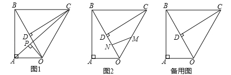

# Mathematics - 题目 2356

**ID**: b7b2dde6d03144b6a3bc3cd8b2e8155a
**年级**: Grade 9
**难度**: Hard
**题型**: Calculation

## 题目
已知 ${\rm{R}}{\rm{t}}Δ{\rm{O}}{\rm{A}}{\rm{B}}$ ， $\angle OAB=90{}^\circ $ ， $\angle ABO=30{}^\circ $ ，斜边 $OB=4$ ，将 ${\rm{R}}{\rm{t}}Δ{\rm{O}}{\rm{A}}{\rm{B}}$ 绕点 $O$ 顺时针旋转 $60{}^\circ $ ，如图1，连接 $BC$ ．（1）填空： $\angle OBC=$${}^\circ $ ；（2）如图1，连接 $AC$ ，作 $OP\bot AC$ ，垂足为 $P$ ，求 $OP$ 的长度；（3）如图2，点 $M$ ， $N$ 同时从点 $O$ 出发，在 $ΔOCB$ 边上运动， $M$ 沿 $O\to C\to B$ 路径匀速运动， $N$ 沿 $O\to B\to C$ 路径匀速运动，当两点相遇时运动停止，已知点 $M$ 的运动速度为1.​​​​​​​‌5单位 $/$ 秒，点 $N$ 的运动速度为1单位 $/$ 秒，设运动时间为 $x$ 秒， $\Delta OMN$ 的面积为 $y$ ，求当 $x$ 为何值时 $y$ 取得最大值？最大值为多少？

## 解答

1. （1）由旋转性质可知：OB＝OC，∠BOC＝60°，
2. ∴△OBC是等边三角形，
3. ∴∠OBC＝60°．
4. 故答案为60．
5. （2）如图1中．
6. 
7. ∵OB＝4，∠ABO＝30°，
8. ∴OA$=\frac {1}{2}$OB＝2，AB$=\sqrt {3}$OA＝2 $\sqrt {3}$ ，
9. ∴S_{△}_{AOC}$=\frac {1}{2}$ •OA•AB$=\frac {1}{2}\times $ 2×2 $\sqrt {3}=2\sqrt {3}$ ．
10. ∵△BOC是等边三角形，
11. ∴∠OBC＝60°，∠ABC＝∠ABO+∠OBC＝90°，
12. ∴AC$=\sqrt {AB{^{2}}+BC{^{2}}}=2\sqrt {7}$ ，
13. ∴OP$=\frac {2S{{}_{\vartriangle AOC}}}{AC}=\frac {4\sqrt {3}}{2\sqrt {7}}=\frac {2\sqrt {21}}{7}$ ．
14. （3）①当0＜x$\leqslant \frac {8}{3}$ 时，M在OC上运动，N在OB上运动，此时过点N作NE⊥OC且交OC于点E．
15. 
16. 则NE＝ON•sin60° $=\frac {\sqrt {3}}{2}$x，
17. ∴S_{△}_{OMN}$=\frac {1}{2}$ •OM•NE$=\frac {1}{2}\times $ 1.5x$\times \frac {\sqrt {3}}{2}$x，
18. ∴y$=\frac {3\sqrt {3}}{8}$x^{2}，
19. ∴x$=\frac {8}{3}$ 时，y有最大值，最大值 $=\frac {8\sqrt {3}}{3}$ ．
20. ②当 $\frac {8}{3}＜$x⩽4时，M在BC上运动，N在OB上运动．
21. 
22. 作MH⊥OB于H．
23. 则BM＝8﹣1.5x，MH＝BM•sin60° $=\frac {\sqrt {3}}{2}$ （8﹣1.5x），
24. ∴y$=\frac {1}{2}\times $ON×MH$=-\frac {3\sqrt {3}}{8}$x^{2}+2 $\sqrt {3}$x．
25. 当x$=\frac {8}{3}$ 时，y取最大值，y$＜\frac {8\sqrt {3}}{3}$ ，
26. ③当4＜x⩽4.8时，M、N都在BC上运动，
27. 
28. 作OG⊥BC于G．MN＝12﹣2.5x，OG＝AB＝2 $\sqrt {3}$ ，
29. ∴y$=\frac {1}{2}$ •MN•OG＝12 $\sqrt {3}-\frac {5\sqrt {3}}{2}$x，
30. 当x＝4时，y有最大值，最大值＝2 $\sqrt {3}$ ．
31. 综上所述：y有最大值，最大值为 $\frac {8\sqrt {3}}{3}$ ．

## 知识点

**中文**:
  - 含30度角的直角三角形
  - 平面图形
  - 等边三角形的判定与性质
  - 四边形综合

**English**:
  - Right Triangle with 30° Angle
  - Plane Figures
  - Determination and Properties
  - Comprehensive Quadrilateral Problems

---
