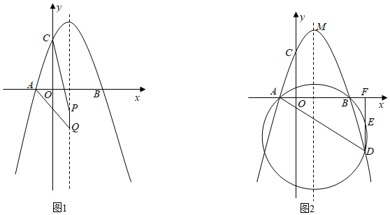

# Mathematics - 题目 1017

**ID**: b7d235dd5de24f839e89df5a17256ee1
**年级**: Grade 9
**难度**: Hard
**题型**: Calculation

## 题目
如图1，在平面直角坐标系xOy中，抛物线 $y=ax{^{2}}+bx+c$ 与x轴分别相交于A（ $-1$ ，0）、B（3，0）两点，与y轴相交于点C（0，3）．（1）求出这条抛物线的解析式及顶点M的坐标；​​​​​​​‌（2）PQ是抛物线对称轴上长为1的一条动线段（点P在点Q上方），求AQ+QP+PC的最小值；（3）如图2，点D是第四象限内抛物线上一动点，过点D作DF⊥x轴，垂足为F，△ABD的外接圆与DF相交于点E．试问：线段EF的长是否为定值？如果是，请求出这个定值；如果不是，请说明理由．

## 解答

1. 解：（1）根据表格可得出A（-1，0），B（3，0），C（0，3），
2. 设抛物线解析式为y=a（x+1）（x-3），
3. 将C（0，3）代入，得：3=a（0+1）（0-3），
4. 解得：a=-1，
5. ∴y=-（x+1）（x-3）=-x^{2}+2x+3=-（x-1）^{2}+4，
6. ∴该抛物线解析式为
7. （2）如图1，将点C沿y轴向下平移1个单位得C′（0，2），连接BC′交抛物线对称轴x=1于点Q′，过点C作CP′∥BC′，交对称轴于点P′，连接AQ′，
8. 
9. ∵A、B关于直线x=1对称，
10. ∴AQ′=BQ′，
11. ∵CP′∥BC′，P′Q′∥CC′，
12. ∴四边形CC′Q′P′是平行四边形，
13. ∴CP′=C′Q′，Q′P′=CC′=1，
14. 在Rt△BOC′中，BC′= $\sqrt {OC\prime {^{2}}+OB{^{2}}}=\sqrt {13}$ ，
15. ∴AQ′+Q′P′+P′C=BQ′+C′Q′+Q′P′=BC′+Q′P′= $\sqrt {13}+1$ ，
16. 此时，C′、Q′、B三点共线，BQ′+C′Q′的值最小，
17. ∴AQ+QP+PC的最小值为 $\sqrt {13}+1$ ；
18. （3）线段EF的长为定值1.
19. 
20. 如图2，连接BE，
21. 设D（t，-t^{2}+2t+3），且t＞3，
22. ∵EF⊥x轴，
23. ∴DF=-（-t^{2}+2t+3）=t^{2}-2t-3，
24. ∵F（t，0），
25. ∴BF=OF-OB=t-3，AF=t-（-1）=t+1，
26. ∵四边形ABED是圆内接四边形，
27. ∴∠DAF+∠BED=180°，
28. ∵∠BEF+∠BED=180°，
29. ∴∠DAF=∠BEF，
30. ∵∠AFD=∠EFB=90°，
31. ∴△AFD∽△EFB，
32. ∴ $\frac {EF}{BF}=\frac {AF}{DF}$ ，
33. ∴ $\frac {EF}{t-3}=\frac {t+1}{t{^{2}}-2t-3}$
34. 解得EF=1
35. ∴线段EF的长为定值1．

## 知识点

**中文**:
  - 二次函数的综合
  - 平行四边形的判定与性质
  - 相似三角形的判定与性质综合
  - 待定系数法求二次函数解析式
  - 圆内接四边形

**English**:
  - Comprehensive Quadratic Function Problems
  - Determination and Properties
  - Determination and Properties
  - Finding Quadratic Expressions by Undetermined Coefficients
  - Cyclic Quadrilaterals

---
