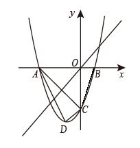

# Mathematics - 题目 1633

**ID**: c4abfcb40e884bb7a8d54339c76596fe
**年级**: Grade 9
**难度**: Hard
**题型**: Calculation

## 题目
如图，抛物线 $y=\left ({x-1}\right )\left ({x+b}\right )$ 与 $x$ 轴交于 $A$ 、 $B$ 两点，与 $y$ 轴交于点 $C$ ，抛物线的顶点为 $D$ ，连接 $AC$ 、 $BC$ ， ${\tan}\angle OBC=3$ ．（1）求抛物线的顶点 $D$ 的坐标．（2）求证： $ΔACD∽ΔCOB$ ．（3）点 $Р$ 在抛物线上，点 $Q$ 在直线 $y=x$ 上，是否存在点 $Р$ 、 $Q$ 使以点 $Р$ 、 $Q$ 、 $C$ 、 $O$ 为顶点的四边形是平行四边形？若存在，请直接写出点 $Р$ 的坐标；​​​​​​​‌若不存在，请说明理由．

## 解答

1. 解：（1）∵抛物线y＝（x﹣1）（x+b）（b＞0）与x轴交于A、B两点（点A在点B的左边），
2. ∴y＝0时，x＝1或x＝﹣b，
3. ∴A（﹣b，0），B（1，0），
4. ∵tan∠OBC＝3．
5. ∴OC＝3，
6. ∴C点的坐标为（0，﹣3），
7. ∴（0﹣1）（0+b）＝﹣3，
8. 解得b＝3，
9. ∴抛物线的解析式为y＝（x﹣1）（x+3），即y＝x^{2}+2x﹣3＝（x+1）^{2}﹣4，
10. ∴抛物线的顶点D的坐标为（﹣1，﹣4）；
11. （2）证明：如图1，
12. 令y＝0，则x＝1或x＝﹣3，故点A（﹣3，0），
13. 
14. ∵C（0，﹣3），D（﹣1，﹣4），
15. ∴AD$=\sqrt {2{^{2}}+4{^{2}}}=$ 2 $\sqrt {5}$ ，CD$=\sqrt {1{^{2}}+1{^{2}}}=\sqrt {2}$ ，AC$=\sqrt {3{^{2}}+3{^{2}}}=$ 3 $\sqrt {2}$ ，
16. ∴AD^{2}＝CD^{2}+AC^{2}，
17. ∴∠ACD＝90°，
18. ∵∠COB＝90°， ${\rm \frac {AC}{CD}=\frac {OC}{OB}=}$ 3，
19. ∴∠ACD＝∠COB， ${\rm \frac {AC}{OC}=\frac {CD}{OB}}$ ，
20. ∴△ACD∽△COB；
21. （3）存在，理由：
22. ①当OC是平行四边形的一条边时，
23. 
24. 设：点P（m，m^{2}+2m﹣3），点Q（m，m），
25. 则PQ＝OC＝3，
26. PQ＝|m^{2}+2m﹣3﹣m|＝3，
27. 解得：m＝﹣1或2或0或﹣3（舍去0），
28. 故m＝﹣1或2或﹣3；
29. ②当CO是平行四边形的对角线时，
30. 
31. 设点P（m，m^{2}+2m﹣3），点Q（n，n），
32. 由中点可得： $\begin{cases}m+n=0\\m{^{2}}+2m-3+n=-3\end{cases}$ ，
33. 解得：m＝0或﹣1（舍去0）；
34. 故m＝﹣1或2或﹣3，
35. 则点P（﹣1，﹣4）或（2，5）或（﹣3，0）．

## 知识点

**中文**:
  - 二次函数的图象和性质
  - 二次函数的综合
  - 平行四边形的性质

**English**:
  - Graphs and Properties of Quadratic Functions
  - Comprehensive Quadratic Function Problems
  - Properties of Parallelograms

---
