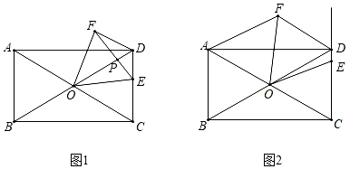

# Mathematics - 题目 2588

**ID**: c5db41ce5afb408b809c2cf169a7849d
**年级**: Grade 9
**难度**: Hard
**题型**: Calculation

## 题目
如图1，在矩形ABCD中，AB＝1，对角线AC，BD相交于点O，∠COD＝60°，点E是线段CD上一点，连接OE，将线段OE绕点O逆时针旋转60°得到线段OF，连接DF．（1）求证：DF＝CE；​​​​​​​‌（2）连接EF交OD于点P，求DP的最大值；（3）如图2，点E在射线CD上运动，连接AF，在点E的运动过程中，若AF＝AB，求OF的长．

## 解答

1. （1）证明：由题意知∠FOE＝∠DOC＝60°，
2. ∴∠FOE﹣∠DOE＝∠DOC﹣∠DOE，即∠FOD＝∠EOC，
3. 在矩形ABCD中，AC＝BD＝2OC＝2OD，
4. ∴OC＝OD，
5. 又∵OF＝OE，
6. ∴△FOD≌△EOC（SAS），
7. ∴DF＝CE；
8. （2）解：在△ODC中，OD＝OC，∠COD＝60°，
9. ∴△OCD是等边三角形，∠OCD＝60°，
10. 又△FOD≌△EOC，
11. ∴∠FDO＝∠ECO＝60°，
12. 在△OEF中，OE＝OF，∠EOF＝60°，
13. ∴△OEF是等边三角形，∠OEF＝60°，
14. ∴180°﹣∠FDP﹣∠FPD＝180°﹣∠OEP﹣∠OPE，即∠DFP＝∠DOE，
15. 又∠FDP＝∠ODE＝60°，
16. ∴△FDP∽△ODE，
17. ∴ ${\rm \frac {DF}{DO}=\frac {DP}{DE}}$ ，
18. 设DF＝CE＝x，则DE＝1﹣x，
19. ∴ ${\rm \frac {x}{1}=\frac {DP}{1-x}}$ ，
20. ∴DP＝﹣x^{2}+x＝ $-{\left({x-\frac {1}{2}}\right)^{2}}+\frac {1}{4}$ ，
21. ∴DP的最大值为 $\frac {1}{4}$ ；
22. （3）解：①在矩形ABCD中，AB＝1，∠COD＝60°，
23. ∴AD＝ $\sqrt {3}$ ，∠OAD＝∠ODA＝30°，
24. ∴∠FDA＝∠FDO﹣∠ODA＝30°，
25. 如图1，过点F作FM⊥AD于点M，
26. 
27. 设FM＝m，则MD＝ $\sqrt {3}$ m，AM＝ $\sqrt {3}$ - $\sqrt {3}$ m，
28. 又∵AF＝AB＝1，
29. ∴在Rt△AFM中，AM^{2}+FM^{2}＝AF^{2}，
30. ∴ $m{^{2}}+(\sqrt {3}-\sqrt {3}m){^{2}}=1$ ，
31. ∴m_{1}＝ $\frac {1}{2}$ ，m_{2}＝1（舍去），
32. ∴sin∠FAM＝ $\frac {1}{2}$ ，
33. ∴∠FAM＝30°，
34. ∴∠FAO＝60°，且AF＝AB＝AO，
35. ∴△AOF是等边三角形，
36. ∴OF＝1；
37. ②如图2，过点A作AN⊥DF于点N，则∠FDA＝30°，
38. 
39. ∴∠DAN＝60°，AN＝ ${\rm \frac {1}{2}AD=\frac {\sqrt {3}}{2}}$  ，
40. ∴cos∠FAN＝ $\frac {\sqrt {3}}{2}$ ，
41. ∴∠FAN＝30°，
42. ∴∠FAO＝120°，
43. 又∠AOD＝120°，
44. ∴∠FAO＝∠AOD，
45. 又AF＝AO＝OD，
46. ∴△OAF≌△AOD（SAS），
47. ∴OF＝AD＝ $\sqrt {3}$ ．
48. 综合以上可得，OF＝1或 $\sqrt {3}$ ．

## 知识点

**中文**:
  - y=ax²+bx+c的图象与性质
  - 等边三角形的判定与性质
  - 旋转的性质
  - 相似三角形的判定与性质综合
  - 解直角三角形
  - 全等三角形的判定与性质

**English**:
  - Graph and Properties of y=ax²+bx+c
  - Determination and Properties
  - Properties of Rotation
  - Determination and Properties
  - Solving Right Triangles
  - Determination and Properties

---
