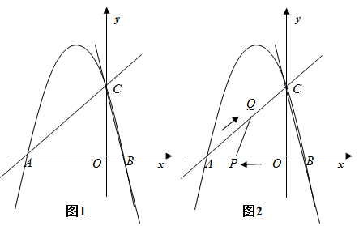

# Mathematics - 题目 3133

**ID**: d4b217ff4caf41569871fa7d6aa6b2eb
**年级**: Grade 9
**难度**: Hard
**题型**: Calculation

## 题目
综合与实践如图1，抛物线y＝﹣ $\frac {8}{3}$x^{2}﹣ $\frac {9}{4}$x+6与x轴交于点A和点B（点A在点B的左侧），与y轴交于点C．（1）求直线AC的表达式；​​​​​​​‌（2）点E在抛物线的对称轴上，在平面内是否存在点F，使得以点A，C，E，F为顶点的四边形是矩形？若存在，请直接写出点E的坐标；若不存在，请说明理由；（3）如图2，设点P从点O出发以1个单位长度/秒的速度向终点A运动，同时点Q从点A出发以 $\frac {5}{4}$ 个单位长度/秒的速度向终点C运动，运动时间为t秒，当∠OPQ的平分线恰好经过OC的中点时，求t的值．

## 解答

1. 解：(1)令 $y=0$ ，得： $-\frac {3}{8}x{^{2}}-\frac {9}{4}x+6=0$ ，
2. 解得： $x{{}_{1}}=-8$ ， $x{{}_{2}}=2$ ，
3. $A(-8,0)$ ， $B(2,0)$ ，
4. 令 $x=0$ ，得： $y=6$ ，
5. $C(0,6)$ ，
6. ∴直线AC的表达式： $y=\frac {3}{4}x+6$ ，
7. (2)对称轴： $x=\frac {-8+2}{2}=-3$ ，
8. 设 $E(-3,m)$ ， $A(-8,0)$ ， $C(0,6)$ ，
9. 由两点间距离公式得：
10. $AC=10$ ， $AE=\sqrt {25+m{^{2}}}$ ， $CE=\sqrt {9+(m-6){^{2}}}$ ，
11. ∵A、C、E、F为矩形，
12. ∴A、C、E三点形成 $Rt\Delta $ ，
13. ①当 $\angle CAE=90{}^\circ $ 时，
14. ∴ $AC{^{2}}+AE{^{2}}=CE{^{2}}$ ，
15. ∴ $100+25+m{^{2}}=9+(m-6){^{2}}$ ，
16. 解得： $m=-\frac {20}{3}$ ，
17. $E{{}_{1}}(-3,-\frac {20}{3})$ ，
18. ②当 $\angle ECA=90{}^\circ $ ，
19. ∴ $AC{^{2}}+CE{^{2}}=AE{^{2}}$ ，
20. ∴ $100+9+(m-6){^{2}}=25+m{^{2}}$ ，
21. 解得： $m=10$ ，
22. $E{{}_{2}}(-3,10)$ ，
23. ③当 $\angle AEC=90{}^\circ $ ，
24. ∴ $AE{^{2}}+CE{^{2}}=AC{^{2}}$ ，
25. ∴ $25+m{^{2}}+9+(m-6){^{2}}=100$ ，
26. 解得： $m{{}_{1}}=3+2\sqrt {6}$ ， $m{{}_{2}}=3-2\sqrt {6}$ ，
27. $E{{}_{3}}(-3,3+2\sqrt {6})$ ， $E{{}_{4}}(-3,3-2\sqrt {6})$ ，
28. 综上所述： $E{{}_{1}}(-3,-\frac {20}{3})$ 、 $E{{}_{2}}(-3,10)$ 、 $E{{}_{3}}(-3,3+2\sqrt {6})$ 、 $E{{}_{4}}(-3,3-2\sqrt {6})$ ，
29. (3)记OC中点D，作 $DH\bot PQ$ 于点H ，过点C作AO平行线交PQ于点G，连接DG，如图所示：
30. 
31. ∵DP为角平分线
32. ∴ $ΔPOD≌ΔPHD$ ，
33. ∴ $DH=OD=3=CD$ ， $\angle PDO=\angle PDH$ ，
34. $\because \angle DCG=\angle DHG=90{}^\circ ,$
35. ∴ $ΔCGD≌ΔHGD$ ，
36. ∴ $\angle HDG=\angle CDG$ ，
37. ∴ $\angle PDG=90{}^\circ $ ，
38. $\therefore \angle PDO+\angle GDC=90{}^\circ =\angle GDC+\angle DGC,$
39. $\therefore \angle PDO=\angle DGC,$
40. ∴ $ΔGCD∽ΔDOP$ ，
41. $\therefore \frac {CG}{DO}=\frac {CD}{OP},$
42. ∴ $CG\cdot OP=CD\cdot OD$ ，
43. $\because OP=t,CD=OD=3,$
44. ∴ $CG=\frac {9}{t}$ ，
45. ∴ $G(-\frac {9}{t},6)$ ，
46. ∴ $P(-t,0)$ ，
47. $\because AQ=\frac {5}{4}t,$
48. $\therefore y{{}_{Q}}=AQ\centerdot {\sin}\angle CAB=\frac {5}{4}t\centerdot \frac {3}{5}=\frac {3}{4}t,$
49. $\because $  直线AC的表达式： $y=\frac {3}{4}x+6$ ，
50. $\therefore $   $Q(-8+t,\frac {3}{4}t)$ ，
51. 设 $PQ$ 的解析式为： $y=mx+n,$
52. $\therefore \begin{cases}-tm+n=0\\\left ({-8+t}\right )m+n=\frac {3}{4}t\end{cases}$
53. $\therefore \begin{cases}m=\frac {3t}{8t-32}\\n=\frac {3t{^{2}}}{8t-32}\end{cases}$
54. PQ的解析式为： $y=\frac {3t}{8t-32}(x+t)$ ，
55. 将点 $G(-\frac {9}{t},6)$ 代入PQ得，
56. $6=\frac {3t}{8t-32}(-\frac {9}{t}+t)$ ，
57. 解得： $t{{}_{1}}=5$ ， $t{{}_{2}}=11$ ，
58. 经检验： $t{{}_{1}}=5$ ， $t{{}_{2}}=11$ 都是原方程的根，但 $t{{}_{2}}=11$ 不合题意，舍去，
59. 故 $t=5$

## 知识点

**中文**:
  - 二次函数的综合
  - 相似三角形的判定与性质综合
  - 全等三角形的判定与性质

**English**:
  - Comprehensive Quadratic Function Problems
  - Determination and Properties
  - Determination and Properties

---
