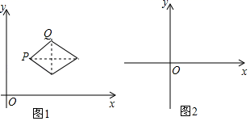

# Mathematics - 题目 2392

**ID**: d9cd0cd75fd34e85ba14330090cd0b07
**年级**: Grade 9
**难度**: Hard
**题型**: Calculation

## 题目
在平面直角坐标系xOy中，若P，Q为某个菱形相邻的两个顶点，且该菱形的两条对角线分别与x轴，y轴平行或重合，则称该菱形为点P，Q的“相关菱形”．图1为点P，Q的“相关菱形”的一个示意图．已知点A的坐标为（1，4），点B的坐标为（b，0）.​​​​​​​‌（1）若b＝3，则R（﹣1，0），S（5，4），T（6，4）中能够成为点A，B的“相关菱形”顶点的是；（2）若点A，B的“相关菱形”为正方形，求b的值；（3）⊙B的半径为 $\sqrt {2}$ ，点C的坐标为（2，4）．若⊙B上存在点M，在线段AC上存在点N，使点M，N的“相关菱形”为正方形，请直接写出b的取值范围．

## 解答

1. （1）如图1中，观察图象可知：R、S能够成为点A，B的“相关菱形”顶点．
2. 
3. 故答案为R，S．
4. （2）如图2中，过点A作AH垂直x轴于H点．
5. ∵点A，B的“相关菱形”为正方形，
6. ∴△ABH为等腰直角三角形．
7. ∵A（1，4），
8. ∴BH＝AH＝4．
9. 
10. ∴b＝﹣3或5．
11. （3）如图3中，观察图象可知，满足条件的b的范围为：﹣5⩽b⩽0或3⩽b⩽8．
12. 

## 知识点

**中文**:
  - 圆的综合问题
  - 菱形的性质
  - 正方形的性质

**English**:
  - Comprehensive Circle Problems
  - Properties of Rhombuses
  - Properties of Squares

---
