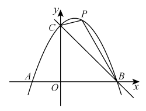

# Mathematics - 题目 2227

**ID**: d9d6c1b1f1174742a4451798900b0574
**年级**: Grade 9
**难度**: Hard
**题型**: Calculation

## 题目
综合与探究如图，抛物线 $y=ax{^{2}}+x+c$ 与x轴交于A， $B\left ({4,0}\right )$ 两点（点A在点B的左侧）．与y轴交于点 $C\left ({0,4}\right )$ ，直线BC经过B，C两点，点Р是第一象限内抛物线上的一个动点，连接PB，PC．(1)求抛物线的函数表达式；​​​​​​​‌(2)设点P的横坐标为n，四边形 $OBPC$ 的面积为S，求S的最大值并求出此时点P的坐标；(3)在（2）的条件下，当S取最大值时，在PC的垂直平分线上是否存在一点M，使 $△BPM$ 是等腰三角形？若存在，请直接写出点M的坐标；若不存在，请说明理由．

## 解答

1. （1）解：由题意，将 $B\left ({4,0}\right )$ ， $C\left ({0,4}\right )$ 代入抛物线 $y=ax{^{2}}+x+c$ ，
2. 得 $\begin{cases}16a+4+c=0\\c=4\end{cases}$ ，解得 $\begin{cases}a=-\frac {1}{2}\\c=4\end{cases}$ ，
3. ∴抛物线的函数表达式为 $y=-\frac {1}{2}x{^{2}}+x+4$ ；
4. （2）如图，过点P作 $PE\bot x$ 轴于点E，交BC于点F，
5. 
6. ∵ $B\left ({4,0}\right )$ ， $C\left ({0,4}\right )$ ，
7. ∴ $OB=OC=4$ ，直线BC的表达式为 $y=-x+4$ ，
8. ∵点P的横坐标为 $n$ ，
9. ∴ $P\left ({n,-\frac {1}{2}n{^{2}}+n+4}\right )$ ， $F\left ({n,-n+4}\right )$ ，
10. ∴ $PF=-\frac {1}{2}n{^{2}}+n+4-\left ({-n+4}\right )=-\frac {1}{2}n{^{2}}+2n$ ，
11. ∴ $S=S{{}_{{\rm{四}}{\rm{边}}{\rm{形}}OBPC}}=S{{}_{\mathrm{△}BOC}}+S{{}_{\mathrm{△}PBF}}+S{{}_{\mathrm{△}PCF}}=\frac {1}{2}OB\cdot OC+\frac {1}{2}PF\cdot BE+\frac {1}{2}PF\cdot OE$
12. $=\frac {1}{2}OB\cdot OC+\frac {1}{2}PF\cdot \left ({BE+OE}\right )=\frac {1}{2}OB\cdot OC+\frac {1}{2}PF\cdot OB$
13. $=\frac {1}{2}\times 4\times 4+\frac {1}{2}\times \left ({-\frac {1}{2}n{^{2}}+2n}\right )\times 4=-n{^{2}}+4n+8$
14. $=-{\left({n-2}\right)^{2}}+12$ ，
15. ∵ $-1<0$ ， $0<n<4$ .
16. ∴当 $n=2$ 时， $S$ 有最大值， $S{{}_{{\rm{最}}{\rm{大}}}}=12$ ，
17. 此时 $-\frac {1}{2}n{^{2}}+n+4=-\frac {1}{2}\times 2{^{2}}+2+4=4$ ，
18. ∴点 $P$ 的坐标为 $\left ({2,4}\right )$ ；
19. （3）由（2）可得：点 $P$ 的坐标为 $\left ({2,4}\right )$ ，点C的坐标为 $\left ({0,4}\right )$ ，
20. 所以 $PC$ 的中点坐标为 $\left ({1,4}\right )$ ，
21. 所以线段 $PC$ 的垂直平分线为直线 $x=1$ ，
22. ∴可设点M的坐标为 $\left ({1,m}\right )$ ，
23. 则 $BM{^{2}}=3{^{2}}+m{^{2}},PM{^{2}}=1{^{2}}+{\left({4-m}\right)^{2}},BP{^{2}}={\left({4-2}\right)^{2}}+4{^{2}}=20$ ，
24. 若 $△BPM$ 是等腰三角形，则有以下三种情况：
25. 当 $BM=BP$ 时， $BM{^{2}}=BP{^{2}}$ ，即 $3{^{2}}+m{^{2}}=20$ ，解得 $m=\pm \sqrt {11}$ ，
26. 此时点P的坐标为 $\left ({1,\sqrt {11}}\right )$ 或 $\left ({1,-\sqrt {11}}\right )$ ；
27. 当 $MB=MP$ 时， $MB{^{2}}=MP{^{2}}$ ，即 $3{^{2}}+m{^{2}}=1{^{2}}+{\left({4-m}\right)^{2}}$ ，解得 $m=1$ ，
28. 此时点P的坐标为 $\left ({1,1}\right )$ ；
29. 当 $PB=PM$ 时， $PB{^{2}}=PM{^{2}}$ ，即 $1{^{2}}+{\left({4-m}\right)^{2}}=20$ ，解得 $m=4\pm \sqrt {19}$ ，
30. 此时点P的坐标为 $\left ({1,4+\sqrt {19}}\right )$ 或 $\left ({1,4-\sqrt {19}}\right )$ ；
31. 综上所述，存在一点M，使 $△BPM$ 是等腰三角形，点 $M$ 的坐标为 $\left ({1,1}\right )$ 或 $\left ({1,4+\sqrt {19}}\right )$ 或 $\left ({1,4-\sqrt {19}}\right )$ 或 $\left ({1,\sqrt {11}}\right )$ 或 $\left ({1,-\sqrt {11}}\right )$ .

## 知识点

**中文**:
  - y=ax²+bx+c的图象与性质
  - 二次函数的综合
  - 等腰三角形的性质
  - 待定系数法求二次函数解析式

**English**:
  - Graph and Properties of y=ax²+bx+c
  - Comprehensive Quadratic Function Problems
  - Properties of Isosceles Triangles
  - Finding Quadratic Expressions by Undetermined Coefficients

---
