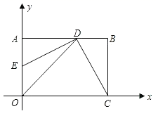

# Mathematics - 题目 3723

**ID**: e6cf82f779654266b921e9c2a5f29615
**年级**: Grade 9
**难度**: Hard
**题型**: Calculation

## 题目
已知：如图，在平面直角坐标系xoy中，矩形OABC的边OA在y轴的正半轴上，OC在x轴的正半轴上，OA=2，OC=3．过原点O作∠AOC的平分线交AB于点D，连接DC，过点D作DE⊥DC，交OA于点E．（1）填空：写出点D、E的坐标：D，E．（2）求过点E、D、C的抛物线的解析式；​​​​​​​‌（3）点G的坐标为（1，0），在位于第一象限内的该抛物线上是否存在点Q，使得直线GQ与AB的交点P与点C、G构成的△PCG是等腰三角形？若存在，请求出点Q的坐标；若不存在，请说明理由．

## 解答

1. （1）∵OA=2，OC=3，OD平分∠AOC，
2. ∴AD=OA=2，∴D（2,2），
3. ∵DE⊥DC，∴∠ADE+∠BDC=90°，
4. ∵∠BCD+∠BDC=90°，
5. ∴∠ADE =∠BCD ，
6. 在Rt△ADE和Rt△BCD中，
7. ∠A=∠B=90°，AD=BC=2，∠ADE =∠BCD ，
8. ∴△ADE≌△BCD，∴AE=BD=1，
9. ∴OE=1,即E（0，1）．
10. （2）设过点E、D、C的抛物线的解析式为 $y=ax{{}^{2}}+bx+c(a\ne 0)$ ，
11. 
12. 把C（3，0）、D（2，2）、E（0，1）三点坐标代入解析式中得：
13. $\begin{cases}9a+3b+1=0\\4a+2b{\rm{+}}1{\rm{=}}2\\c=1\end{cases}$  解得 $\begin{cases}a=-\frac {5}{6}\\b=\frac {13}{6}\\c=1\end{cases}$  ，
14. 故过点E、D、C的抛物线的解析式为 $y=-\frac {5}{6}x{{}^{2}}+\frac {13}{6}+1$ ，
15. （3）设P（t，2），又G（1，0），C（3，0）
16. ∴ $PG{{}^{2}}=(t-1){{}^{2}}+4$ ， $PC{{}^{2}}=(3-t){{}^{2}}+4$ ，GC=2，
17. 有三种情况，分别讨论：
18. ①PG=PC，则 $(t-1){{}^{2}}+4=(3-t){{}^{2}}+4$ ，解得t=2．
19. ∴P（2，2），此时点Q与点P重合，即Q（2，2）；
20. ②若PG=GC，则 $(t-1){{}^{2}}+4=4$ ，解得t=1，
21. ∴P（1，2），此时GP⊥x轴，GP与该抛物线在第一象限内的交点Q的横坐标为1，
22. 代入抛物线解析式可得Q（1， $\frac {7}{3}$ ）；
23. ③若PC=GC，则 $(3-t){{}^{2}}+4=4$ ，解得t=3
24. ∴P（3，2），此时PC=GC=2，∆PCG是等腰直角三角形，
25. 过点Q作QH⊥x轴于点H，
26. 
27. 则QH=GH，设QH=h，即Q（h+1，h）
28. ∴ $-\frac {5}{6}(h+1){{}^{2}}+\frac {13}{6}(h+1)+1=h$ ，解得 $h=\frac {7}{5}$ 或 $h=-2$ （舍去）．
29. ∴Q（ $\frac {12}{5}，\frac {7}{5}$ ）．
30. 综上所述，存在三个满足条件的点Q，使得△PCG是等腰三角形，
31. 分别是： $Q(2,2)$ 或 $Q(1,\frac {7}{3})$ 或 $Q(\frac {12}{5},\frac {7}{5})$ ．

## 知识点

**中文**:
  - 二次函数的综合
  - 旋转的性质

**English**:
  - Comprehensive Quadratic Function Problems
  - Properties of Rotation

---
