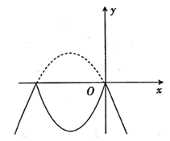

# Mathematics - 题目 1429

**ID**: e8b2eaac7b2b4f73b6c2d095bc5a7dfb
**年级**: Grade 9
**难度**: Hard
**题型**: Calculation

## 题目
定义：如果两个函数 $y{{}_{1}}$ ， $y{{}_{2}}$ 存在 $x$ 取同一个值，使得 $y{{}_{1}}=y{{}_{2}}$ ，那么称 $y{{}_{1}}$ ， $y{{}_{2}}$ 互为“等值函数”，对应的 $x$ 值为 $y{{}_{1}}$ ， $y{{}_{2}}$ 的“等值根”．（1）函数 $y{{}_{1}}=\frac {1}{2}x+b$ 与 $y{{}_{2}}=\frac {3}{x}$ 是否互为“等值函数”？如果是，求出当 $b=1$ 时，两函数的“等值根”；​​​​​​​‌如果不是，请说明理由．（2）如图所示的是 $y\mathrm{=}-\left |{x{^{2}}+2x}\right |$ 的图象，它是由二次函数 $y=-x{^{2}}-2x$ 的图象 $x$ 轴上方的部分沿 $x$ 轴翻折到 $x$ 轴下方，图象的其余部分保持不变得到的．若 $y{{}_{1}}=\frac {1}{2}x+b$ 与 $y{{}_{2}}\mathrm{=}-\left |{x{^{2}}+2x}\right |$ 互为“等值函数”，且有两个“等值根”，求 $b$ 的取值范围．

## 解答

1. 解：（1） $\frac {1}{2}x+b$  $=\frac {3}{x}$ ，
2. 方程两边都乘2x得 $x{^{2}}+2bx-6=0$ ，
3. △= ${\left({2b}\right)^{2}}{\rm{+}}24=4b{^{2}}+24>0$ ，
4. 方程总有两个不等实根，
5. 根据定义两个函数 $y{{}_{1}}$ ， $y{{}_{2}}$ 存在 $x$ 取同一个值，使得 $y{{}_{1}}=y{{}_{2}}$ ，那么称 $y{{}_{1}}$ ， $y{{}_{2}}$ 互为“等值函数”，
6. $\therefore $  函数 $y{{}_{1}}=\frac {1}{2}x+b$ 与 $y{{}_{2}}=\frac {3}{x}$ 互为“等值函数”．
7. 当 $b=1$ ，方程变为 $x{^{2}}+2x-6=0$ ，
8. ∵△= ${\left({2b}\right)^{2}}{\rm{+}}24=4\times 1+24{\rm{=}}28$ ，
9. ∴ $x=\frac {-2\pm 2\sqrt {7}}{2}=-1\pm \sqrt {7}$ ；
10. （2）如图当直线在点A与点O之间运动时与绝对值函数有两个等值根，
11. 当 $y\mathrm{=}-\left |{x{^{2}}+2x}\right |$ =0时，
12. 解得x=-2，x=0，
13. ∴点A（-2，0），点O（0，0），
14. 
15. $y{{}_{1}}=\frac {1}{2}x+b$ 过点A时， $\frac {1}{2}\times \left ({-2}\right )+b=0$ ，
16. 解得 $b{\rm{=}}1$ ，
17. $y{{}_{1}}=\frac {1}{2}x+b$ 过点O时，  $\frac {1}{2}\times 0+b{\rm{=}}0$ ，
18. 解得 $b{\rm{=}}0$ ，
19. ∴ $0<b<1$ ， $y{{}_{1}}=\frac {1}{2}x+b$ 与 $y{{}_{2}}\mathrm{=}-\left |{x{^{2}}+2x}\right |$ 互为“等值函数”，
20. 当 $-2<x<0$ ，二次函数 $y=x{^{2}}{\rm{+}}2x$ ，当 $y{{}_{1}}=\frac {1}{2}x+b$ 与二次函数 $y=x{^{2}}{\rm{+}}2x$ 由一个等值根时，即 $x{^{2}}{\rm{+}}2x{\rm{=}}\frac {1}{2}x+b$ ，
21. 整理得 $x{^{2}}{\rm{+}}\frac {3}{2}x-b{\rm{=}}0$ ，
22. △= $b{^{2}}-4ac=\frac {9}{4}+4b=0$ ，
23. ∴ $b=-\frac {9}{16}$ ，
24. ∴当 $b<-\frac {9}{16}$ ， $y{{}_{1}}=\frac {1}{2}x+b$ 与 $y{{}_{2}}\mathrm{=}-\left |{x{^{2}}+2x}\right |$ 互为“等值函数”，且有两个“等值根”，
25. 
26. ∴ $y{{}_{1}}=\frac {1}{2}x+b$ 与 $y{{}_{2}}\mathrm{=}-\left |{x{^{2}}+2x}\right |$ 互为“等值函数”，且有两个“等值根”， $b$ 的取值范围是 $0<b<1$ 或 $b<-\frac {9}{16}$ ．

## 知识点

**中文**:
  - 二次函数与一元二次方程
  - 公式法解一元二次方程
  - 二次函数的综合

**English**:
  - Quadratic Functions and Quadratic Equations
  - Solving by Quadratic Formula
  - Comprehensive Quadratic Function Problems

---
