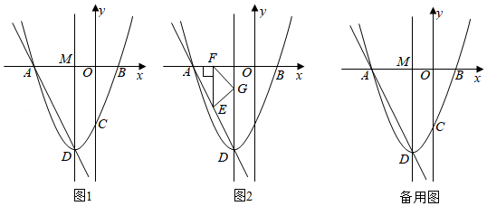

# Mathematics - 题目 3299

**ID**: f1f3c9f4ac184c7d8dd2c55a8aa017e4
**年级**: Grade 9
**难度**: Hard
**题型**: Calculation

## 题目
如图1，抛物线 $y=ax{^{2}}+bx-3$ 与 $x$ 轴交于 $A(-3,0)$ 、 $B(1,0)$ 两点，与 $y$ 轴交于点 $C$ ，点 $D$ 是抛物线的顶点，抛物线的对称轴与 $x$ 轴交于点 $M$ ．（1）请直接写出抛物线的解析式及点 $D$ 的坐标；​​​​​​​‌（2）点 $P$ 是抛物线上的一个动点，当 $\angle PAB=\angle ADM$ 时，请求出点 $P$ 的坐标；（3）如图2，点 $E$ 是线段 $AD$ 的中点，过点 $E$ 作 $EF\bot x$ 轴于点 $F$ ，以 $EF$ 为斜边向右作等腰直角 $ΔEFG$ ．①请直接写出 $GM$ 的长；②将等腰直角 $ΔEFG$ 绕点 $E$ 旋转，当点 $G$ 的对应点 $G^{′}$ 恰好落在直线 $AD$ 上时，请直接写出点 $G^{′}$ 的坐标．

## 解答

1. 解：（1）将 $A(-3,0)$ 、 $B(1,0)$ 代入 $y=ax{^{2}}+bx-3$ 得：
2. $\begin{cases}0=9a-3b-3\\0=a+b-3\end{cases}$ ，解得 $\begin{cases}a=1\\b=2\end{cases}$ ，
3. $\therefore $ 抛物线的解析式为 $y=x{^{2}}+2x-3$ ，
4. $\because y=x{^{2}}+2x-3=(x+1){^{2}}-4$ ，
5. $\therefore $ 抛物线的顶点 $D(-1,-4)$ ；
6. （2）过 $P$ 作 $PQ\bot x$ 轴于 $Q$ ，如图：
7. 
8. 设 $P(t,t{^{2}}+2t-3)$ ，
9. $\because D(-1,-4)$ ， $A(-3,0)$ ，
10. $\therefore AM=2$ ， $DM=4$ ，
11. $\therefore \angle PAB=\angle ADM$ ，
12. $\therefore {\tan}\angle PAB={\tan}\angle ADM$ ，即 $\frac {PQ}{AQ}=\frac {AM}{DM}$ ，
13. $\therefore $  $\frac {|t{^{2}}+2t-3|}{t+3}=\frac {2}{4}$ ，
14. ①当 $t{^{2}}+2t-3>0$ 时， $\frac {t{^{2}}+2t-3}{t+3}=\frac {1}{2}$ ，
15. 解得 $t=\frac {3}{2}$ 或 $t=-3$ （舍去），
16. $\therefore P(\frac {3}{2}$ ， $\frac {9}{4})$ ；
17. ②当 $t{^{2}}+2t-3<0$ 时 $\frac {t{^{2}}+2t-3}{t+3}=-\frac {1}{2}$ ，
18. 解得 $t=\frac {1}{2}$ 或 $t=-3$ （舍去），
19. $\therefore P(\frac {1}{2}$ ， $-\frac {7}{4})$ ，
20. 综上所述， $P$ 的坐标为 $(\frac {3}{2}$ ， $\frac {9}{4})$ 或 $(\frac {1}{2}$ ， $-\frac {7}{4})$ ；
21. （3）①过 $G$ 作 $GH\bot EF$ 于 $H$ ，如图：
22. 
23. $\because D(-1,-4)$ ， $A(-3,0)$ ，点 $E$ 是线段 $AD$ 的中点，
24. $\therefore E(-2,-2)$ ，
25. $\because EF\bot x$ 轴于点 $F$ ，
26. $\therefore F(-2,0)$ ， $EF=2$ ，
27. $\because ΔEFG$ 是等腰直角三角形， $GH\bot EF$ ，
28. $\therefore ΔFHG$ 是等腰直角三角形，
29. $\therefore HG=FH=1$ ，
30. $\therefore G$ 在 $DM$ 上，
31. $\therefore GM=HF=1$ ；
32. ②如图：
33. 
34. 由 $D(-1,-4)$ ， $A(-3,0)$ 可得直线 $AD$ 解析式为 $y=-2x-6$ ，
35. 由①知 $EF=2$ ，
36. $\because ΔEFG$ 是等腰直角三角形，
37. $\therefore EG=\frac {EF}{\sqrt {2}}=\sqrt {2}$ ，
38. $\because $ 将等腰直角 $ΔEFG$ 绕点 $E$ 旋转，点 $G$ 的对应点 $G^{′}$ ，
39. $\therefore EG^{′}=EG=\sqrt {2}$ ，
40. 设 $G^{′}(m,-2m-6)$ ，
41. 而 $E(-2,-2)$ ，
42. $\therefore $  $\sqrt {(m+2){^{2}}+(-2m-6+2){^{2}}}=\sqrt {2}$ ，
43. 整理化简得 $5m{^{2}}+20m-18=0$ ，
44. 解得： $m=\frac {\sqrt {10}-10}{5}$ 或 $m=\frac {-\sqrt {10}-10}{5}$ ，
45. $\therefore G^{′}(\frac {\sqrt {10}-10}{5}$ ， $\frac {-2\sqrt {10}-10}{5})$ 或 $(\frac {-\sqrt {10}-10}{5}$ ， $\frac {2\sqrt {10}-10}{5})$ ．
46. 【点评】本题考查二次函数综合应用，涉及待定系数法、锐角三角函数、等腰直角三角形、旋转等知识，解题的关键是用含字母的代数式表示相关点坐标及相关线段的长度．

## 知识点

**中文**:
  - 二次函数的综合
  - 几何变换——旋转综合题
  - 解直角三角形
  - 待定系数法求二次函数解析式

**English**:
  - Comprehensive Quadratic Function Problems
  - Rotation Comprehensive Problems
  - Solving Right Triangles
  - Finding Quadratic Expressions by Undetermined Coefficients

---
