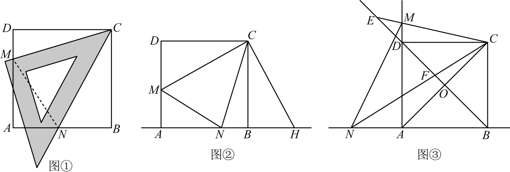

# Mathematics - 题目 678

**ID**: f80b4930b6c14429b9112d5ebe3ab8f1
**年级**: Grade 9
**难度**: Hard
**题型**: Calculation

## 题目
数学兴趣小组探究了以下几何图形．如图①，把一个含有 $45{}^\circ $ 角的三角尺放在正方形 $ABCD$ 中，使 $45{}^\circ $ 角的顶点始终与正方形的顶点 $C$ 重合，绕点 $C$ 旋转三角尺时， $45{}^\circ $ 角的两边 $CM$ ， $CN$ 始终与正方形的边 $AD$ ， $AB$ 所在直线分别相交于点 $M$ ， $N$ ，连接 $MN$ ，可得 $\vartriangle CMN$ ．【探究一】如图②，把 $\vartriangle CDM$ 绕点C逆时针旋转 $90{}^\circ $ 得到 $\vartriangle CBH$ ，同时得到点 $H$ 在直线 $AB$ 上．求证： $\angle CNM=\angle CNH$ ；​​​​​​​‌【探究二】在图②中，连接 $BD$ ，分别交 $CM$ ， $CN$ 于点 $E$ ， $F$ ．求证： $△CEF∽△CNM$ ；【探究三】把三角尺旋转到如图③所示位置，直线 $BD$ 与三角尺 $45{}^\circ $ 角两边 $CM$ ， $CN$ 分别交于点 $E$ ， $F$ ．连接 $AC$ 交 $BD$ 于点 $O$ ，求 $\frac {EF}{NM}$ 的值．

## 解答

1. [探究一]
2. ∵把 $\vartriangle CDM$ 绕点C逆时针旋转 $90{}^\circ $ 得到 $\vartriangle CBH$ ，同时得到点 $H$ 在直线 $AB$ 上，
3. ∴ $CM=CH,\angle MCH=90{}^\circ $ ，
4. ∴ $\angle NCH=\angle MCH-\angle MCN=90{}^\circ -45{}^\circ =45{}^\circ $ ，
5. ∴ $\angle MCN=\angle HCN$ ，
6. 在 $\vartriangle CNM$ 与 $△CNH$ 中
7. $\begin{cases}CM=CH\\\angle MCN=\angle HCN\\CN=CN\end{cases}$
8. ∴ $\vartriangle CNM≌\vartriangle CNH$
9. ∴ $\angle CNM=\angle CNH$
10. [探究二]证明：如图所示，
11. 
12. ∵四边形 $ABCD$ 是正方形，
13. ∴ $\angle DBA=45{}^\circ $ ，
14. 又 $\angle MCN=45{}^\circ $ ，
15. ∴ $\angle FBN=\angle FCE=45{}^\circ $ ，
16. ∵ $\angle EFC=\angle BFN$ ，
17. ∴ $\angle CEF=\angle FNB$ ，
18. 又∵ $\angle CNM=\angle CNH$ ，
19. ∴ $\angle CEF=\angle CNM$ ，
20. 又∵公共角 $\angle ECF=\angle NCM$ ，
21. ∴ $△CEF∽△CNM$ ；
22. [探究三] 证明：∵ $AC,BD$ 是正方形的对角线，
23. ∴ $\angle CDE=\angle CDA+\angle EDM=135{}^\circ $ ， $\angle CAN=180{}^\circ -\angle BAC=135{}^\circ $ ，
24. ∴ $\angle CDE=\angle CAN$ ，
25. ∵ $\angle MCN=\angle DCA=45{}^\circ $ ，
26. ∴ $\angle MCN-\angle DCN=\angle DCA-\angle DCN$ ，
27. 即 $\angle ECD=\angle NCA$ ，
28. ∴ $\vartriangle ECD∽\vartriangle NCA$ ，
29. ∴ $\angle CED=\angle CNA$ ， $\frac {EC}{NC}=\frac {CD}{AC}=\frac {1}{\sqrt {2}}$ ，
30. 如图所示，将 $\vartriangle DMC$ 绕点 $C$ 顺时针旋转 $90{}^\circ $ 得到 $\vartriangle BGC$ ，则点 $G$ 在直线 $AB$ 上．
31. 
32. ∴ $MC=GC$ ， $\angle MCG=90{}^\circ $ ，
33. ∴ $\angle NCG=\angle NCM=45{}^\circ $ ，
34. 又 $CN=CN$ ，
35. ∴ $\vartriangle NCG≌\vartriangle NCM$ ，
36. ∴ $\angle MNC=\angle GNC$ ，
37. ∵ $\angle CNA=\angle CEF$ ，
38. ∴ $\angle CNM=\angle CEF$ ，
39. 又 $\angle ECF=\angle NCM$ ，
40. ∴ $\vartriangle ECF∽\vartriangle NCM$ ，
41. ∴ $\frac {EF}{NM}$  $=$  $\frac {EC}{NC}=\frac {CD}{AC}=\frac {1}{\sqrt {2}}$ ，
42. 即 $\frac {EF}{NM}=\frac {\sqrt {2}}{2}$ ．

## 知识点

**中文**:
  - 全等三角形的判定与性质
  - 正方形的性质
  - 几何变换——旋转综合题
  - 相似三角形的判定与性质综合

**English**:
  - Determination and Properties
  - Properties of Squares
  - Rotation Comprehensive Problems
  - Determination and Properties

---
