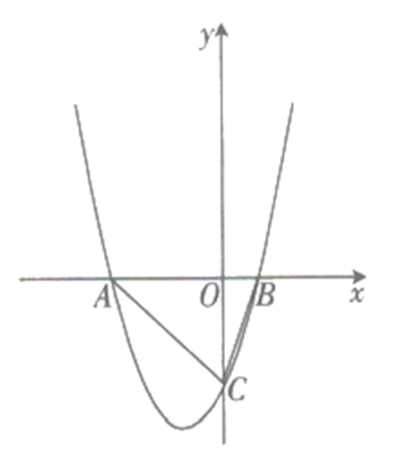

# Mathematics - 题目 3921

**ID**: f8a3d1b492824204974676784d2d7535
**年级**: Grade 9
**难度**: Hard
**题型**: Calculation

## 题目
如图，抛物线 $y=x{^{2}}-\left ({a+1}\right )x+a$ 与 $x$ 轴交于 $A,B$ 两点(点 $A$ 位于点 $B$ 的左侧)，与 $y$ 轴的负半轴交于点 $C$ ．$\left ({1}\right )$ 求点 $B$ 的坐标．$\left ({2}\right )$ 若 $\vartriangle ABC$ 的面积为 $6$ ．①求这条抛物线相应的函数解析式．②在拋物线上是否存在一点 $P,$ 使得 $\angle POB=\angle CBO$ ？若存在，请求出点 $P$ 的坐标；​​​​​​​‌若不存在，请说明理由．

## 解答

1. 解： $\left ({1}\right )$ 当 $y=0$ 时， $x{^{2}}-\left ({a+1}\right )x+a=0,$
2. 解得 $x{{}_{1}}=1,x{{}_{2}}=a.$
3. $\because $ 点 $A$ 位于点 $B$ 的左侧，与 $y$ 轴的负半轴交于点 $C,$
4. $\therefore a<0,$
5. $\therefore $ 点 $B$ 坐标为 $\left ({1,0}\right )$ ．
6. $\left ({2}\right )①$ 由 $\left ({1}\right )$ 可得，点 $A$ 的坐标为 $\left ({a,0}\right )$ ，点 $C$ 的坐标为 $\left ({0,a}\right ),a<0,$
7. $\therefore AB=1-a,OC=-a$
8. $\because \vartriangle ABC$ 的面积为 $6,$
9. $\therefore \frac {1}{2}\left ({1-a}\right )\cdot (-a)=6,$
10. $\therefore a{{}_{1}}=-3,a{{}_{2}}=4$ ．
11. $\because a<0,$
12. $\therefore a=-3$
13. $y=x{^{2}}+2x-3.$
14. $②\because $ 点 $B$ 的坐标为 $\left ({1,0}\right ),$ 点 $C$ 的坐标为 $\left ({0,-3}\right )$ ，
15. $\therefore $ 设直线 $BC$ 的解析式为 $y=kx-3,$
16. 则 $0=k-3,$
17. $\therefore k=3$ ．
18. $\because \angle POB=\angle CBO,$
19. $\therefore $ 当点 $P$ 在 $x$ 轴上方时，直线 $OP//$ 直线 $BC,$
20. $\therefore $ 直线 $OP$ 的函数解析式 $y=3x,$ 为
21. 则 $\begin{cases}y=3x,\\y=x{^{2}}+2x-3,\end{cases}$
22. $\therefore \begin{cases}x{{}_{1}}=\frac {1-\sqrt {13}}{2}\\y{{}_{1}}=\frac {3-3\sqrt {13}}{2}\end{cases}$ (舍去)， $\begin{cases}x{{}_{2}}=\frac {1+\sqrt {13}}{2}\\y{{}_{2}}=\frac {3+3\sqrt {13}}{2}\end{cases}$
23. $\therefore $ 点的 $P$ 坐标为 $\left ({\frac {1+\sqrt {13}}{2},\frac {3+3\sqrt {13}}{2}}\right )$ ；
24. 当点 $P$ 在 $x$ 轴下方时，直线 $OP^{′}$ 与直线 $OP$ 关于 $x$ 轴对称，
25. 则直线 $OP^{′}$ 的函数解析式为 $y=-3x,$
26. 则 $\begin{cases}y=-3x,\\y=x{^{2}}+2x-3,\end{cases}$
27. $\therefore \begin{cases}x{{}_{1}}=\frac {-5-\sqrt {37}}{2}\\y{{}_{1}}=\frac {15+3\sqrt {37}}{2}\end{cases}$ (舍去)， $\begin{cases}x{{}_{2}}=\frac {-5+\sqrt {37}}{2}\\y{{}_{2}}=\frac {15-3\sqrt {37}}{2}\end{cases}$
28. $\therefore $ 点 $P^{′}$ 的坐标为 $\left ({\frac {-5+\sqrt {37}}{2},\frac {15-3\sqrt {37}}{2}}\right )$
29. 综上可得，点 $P$ 的坐标为 $\left ({\frac {1+\sqrt {13}}{2},\frac {3+3\sqrt {13}}{2}}\right )$ 或 $\left ({\frac {-5+\sqrt {37}}{2},\frac {15-3\sqrt {37}}{2}}\right )$

## 知识点

**中文**:
  - 二次函数的综合
  - 图形问题
  - 几何问题

**English**:
  - Comprehensive Quadratic Function Problems
  - Geometric Problems
  - Geometry Problems

---
