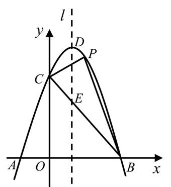

# Mathematics - 题目 2138

**ID**: f8e56f7a536043c7804af4395ad03e02
**年级**: Grade 9
**难度**: Hard
**题型**: Calculation

## 题目
如图，抛物线 $y=ax{^{2}}+bx+8(a\ne 0)$ 与x轴交于点 $A\left ({-2,0}\right )$ 和点 $B\left ({8,0}\right )$ ，与y轴交于点C，顶点为D，连接 $AC,BC,BC$ 与抛物线的对称轴l交于点E．（1）求抛物线的表达式；​​​​​​​‌（2）点P是第一象限内抛物线上的动点，连接 $PB,PC$ ，当 $S{{}_{\vartriangle PBC}}=\frac {3}{5}S{{}_{\vartriangle ABC}}$ 时，求点P的坐标；（3）点N是对称轴l右侧抛物线上的动点，在射线 $ED$ 上是否存在点M，使得以点M，N，E为顶点的三角形与 $\vartriangle OBC$ 相似？若存在，求点M的坐标；若不存在，请说明理由．

## 解答

1. （1） $\because $ 抛物线 $y=ax{^{2}}+bx+8(a\ne 0)$ 过点 $A\left ({-2,0}\right )$ 和点 $B\left ({8,0}\right )$
2. $\therefore \begin{cases}4a-2b+8=0\\64a+8b+8=0\end{cases}$
3. $\therefore \begin{cases}a=-\frac {1}{2}\\b=3\end{cases}$
4. $\therefore $ 抛物线解析式为： $y=-\frac {1}{2}x{^{2}}+3x+8$
5. （2）当 $x=0$ 时， $y=8$
6. $\therefore C\left ({0,8}\right )$
7. $\therefore $ 直线BC解析式为： $y=-x+8$
8. $\because S{{}_{\vartriangle ABC}}=\frac {1}{2}\cdot AB\cdot OC=\frac {1}{2}\times 10\times 8=40$
9. $\therefore S{{}_{\vartriangle PBC}}=\frac {3}{5}S{{}_{\vartriangle ABC}}=24$
10. 过点P作PG $\bot $  $x$ 轴，交 $x$ 轴于点G，交BC于点F
11. 设 $P\left ({t,-\frac {1}{2}t{^{2}}+3t+8}\right )$
12. $\therefore F\left ({t,-t+8}\right )$
13. $\therefore PF=-\frac {1}{2}t{^{2}}+4t$
14. $\therefore S{{}_{\vartriangle PBC}}=\frac {1}{2}PF\cdot OB=24$
15. 即 $\frac {1}{2}\times \left ({-\frac {1}{2}t{^{2}}+4t}\right )\times 8=24$
16. $\therefore t{{}_{1}}=2,t{{}_{2}}=6$
17. $\therefore P{{}_{1}}\left ({2，12}\right )，P{{}_{2}}\left ({6，8}\right )$
18. 
19. （3） $\because C\left ({0，8}\right ),B\left ({8，0}\right )，\angle COB{\rm{=}}90{}^\circ $
20. $\therefore \vartriangle OBC$ 为等腰直角三角形
21. 抛物线 $y=-\frac {1}{2}x{^{2}}+3x+8$ 的对称轴为 $x=-\frac {b}{2a}=-\frac {3}{2\times \left ({-\frac {1}{2}}\right )}=3$
22. $\therefore $ 点E的横坐标为3
23. 又 $\because $ 点E在直线BC上
24. $\therefore $ 点E的纵坐标为5
25. $\therefore E\left ({3，5}\right )$
26. 设 $M\left ({3，m}\right ),N\left ({n,-\frac {1}{2}n{^{2}}+3n+8}\right )$
27. ①当MN=EM， $\angle EMN=90{}^\circ $ , $△NME\sim △COB$ 时
28. $\begin{cases}m-5=n-3\\-\frac {1}{2}n{^{2}}+3n+8=m\end{cases}$
29. 解得 $\begin{cases}n=6\\m=8\end{cases}$ 或 $\begin{cases}n=-2\\m=0\end{cases}$ （舍去）
30. $\therefore $ 此时点M的坐标为 $\left ({3,8}\right )$
31. 
32. ②当ME=EN， $\angle MEN=90{}^\circ $ 时
33. $\begin{cases}m-5=n-3\\-\frac {1}{2}n{^{2}}+3n+8=5\end{cases}$
34. 解得： $\begin{cases}m=5+\sqrt {15}\\n=3+\sqrt {15}\end{cases}$ 或 $\begin{cases}m=5-\sqrt {15}\\n=3-\sqrt {15}\end{cases}$ （舍去）
35. $\therefore $ 此时点M的坐标为 $\left ({3,5+\sqrt {15}}\right )$
36. 
37. ③当MN=EN， $\angle MNE=90{}^\circ $ 时
38. 连接CM，易知当N为C关于对称轴l的对称点时， $△MNE\sim △COB$ ，
39. 此时四边形CMNE为正方形
40. $\therefore CM=CE$
41. $\because C\left ({0,8}\right ),E\left ({3,5}\right ),M\left ({3,m}\right )$
42. $\therefore CM=\sqrt {3{^{2}}+{\left({m-8}\right)^{2}}},CE=\sqrt {3{^{2}}+{\left({5-8}\right)^{2}}}=3\sqrt {2}$
43. $\therefore \sqrt {3{^{2}}+{\left({m-8}\right)^{2}}}=3\sqrt {2}$
44. 解得： $m{{}_{1}}=11,m{{}_{2}}=5$ （舍去）
45. 此时点M的坐标为 $\left ({3，11}\right )$
46. 
47. 在射线 $ED$ 上存在点M，使得以点M，N，E为顶点的三角形与 $\vartriangle OBC$ 相似，点M的坐标为： $\left ({3,8}\right )$ ， $\left ({3,5+\sqrt {15}}\right )$ 或 $\left ({3，11}\right )$ ．

## 知识点

**中文**:
  - 二次函数的综合
  - 等腰三角形的性质
  - 相似三角形的判定与性质综合
  - 待定系数法求二次函数解析式

**English**:
  - Comprehensive Quadratic Function Problems
  - Properties of Isosceles Triangles
  - Determination and Properties
  - Finding Quadratic Expressions by Undetermined Coefficients

---
