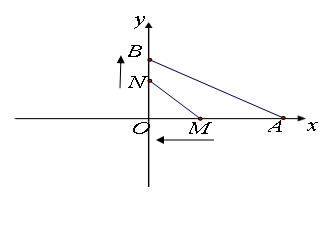
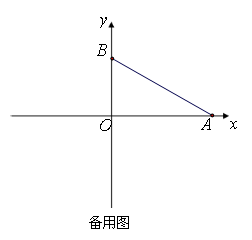

# Mathematics - 题目 3869

**ID**: fed53c2891974d8092872de7d3fe0ab1
**年级**: Grade 9
**难度**: Hard
**题型**: Calculation

## 题目
如图，在平面直角坐标系中，点A的坐标为（6，0），点B的坐标为（0，2），点M从点A出发沿x轴负方向以每秒3cm的速度移动，同时点N从原点出发沿y轴正方向以每秒1cm的速度移动．设移动的时间为t秒．（1）若点M在线段OA上，试问当t为何值时，△ABO与以点O、M、N为顶点的三角形相似？（2）若直线y=x与△OMN外接圆的另一个交点是点C．①试说明：当0<t<2时，OM、ON、OC在移动过程满足OM+ON= $\sqrt {2}$ OC；​​​​​​​‌②试探究：当t>2时，OM、ON、OC之间的数量关系是否发生变化，并说明理由．

## 解答

1. （1）由题意，得OA=6，OB=2．
2. 当0<t<2时，OM=6-3t，ON=t．
3. 若△ABO∽△MNO，则 $\frac {OA}{OM}=\frac {OB}{ON}$ ，即 $\frac {6}{6-3t}=\frac {2}{t}$ ．解得t=1．
4. 若△ABO∽△NMO，则 $\frac {OA}{ON}=\frac {OB}{OM}$ ，即 $\frac {6}{t}=\frac {2}{6-3t}$ ．解得t=1.8．
5. 综上，当t为1或1.8时，△ABO与以点O、M、N为顶点的三角形相似．
6. （2）①当0＜t＜2时，在ON的延长线的截取ND=OM．
7. ∵直线y=x与x轴的夹角为 $45{}^\circ $ ，∴OC平分∠AOB．
8. ∴∠AOC=∠BOB．
9. ∴ $\overset ⌢{{CN}}=\overset ⌢{{CM}}$ ．
10. ∴CN=CM．
11. 又∵ 在⊙O中∠CNO+∠CMO=180°，∠DNC+∠CNO=180°，
12. ∴∠CND=∠CMO．
13. ∴△CND≌△CMO．
14. ∴CD=CO，∠DCN=∠OCM．
15. 又∵∠AOB=90°，∴MN为⊙O的直径．
16. ∴∠MCN=90°．
17. ∴∠OCM+∠OCN=90°．
18. ∴∠DCN+∠OCN=90°．
19. ∴∠OCD=90°,
20. 又∵CD=CO，∴OD= $\sqrt {2}$ OC．
21. ∴ON+ND= $\sqrt {2}$ OC,
22. ∴OM+ON= $\sqrt {2}$ OC．
23. 
24. ②当t>2时，ON-OM= $\sqrt {2}$ OC．
25. 过点C作CD⊥OC交ON于点D．
26. ∵∠COD=45°，
27. ∴△CDO为等腰直角三角形，
28. ∴OD= $\sqrt {2}$ OC，
29. 连接MC，NC，
30. ∵MN为⊙O的直径，∴∠MCN=90°，
31. 又∵在⊙O中，∠CMN=∠CNM=45°，∴MC=NC，
32. 又∵∠OCD=∠MCN=90°，∴∠DCN=∠OCM，
33. ∴△CDN≌△COM．∴DN=OM，
34. 又∵OD= $\sqrt {2}$ OC．，∴ON-DN= $\sqrt {2}$ OC，
35. ∴ON-OM= $\sqrt {2}$ OC．

## 知识点

**中文**:
  - 圆周角定理及推论
  - 相似三角形的判定与性质综合
  - 等腰直角三角形的性质

**English**:
  - Inscribed Angle Theorem
  - Determination and Properties
  - Properties of Isosceles Right Triangles

---
