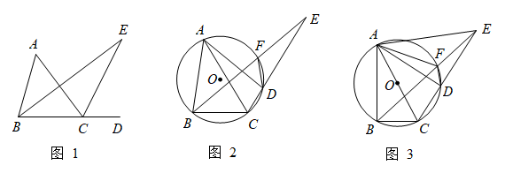

# Mathematics - 题目 2239

**ID**: feec5b4f77bf4b9880eca4aee8ca8b92
**年级**: Grade 9
**难度**: Hard
**题型**: Calculation

## 题目
定义：三角形一个内角的平分线和与另一个内角相邻的外角平分线相交所成的锐角称为该三角形第三个内角的遥望角．（1）如图1，∠E是 ${\rm △\mathit{ABC}}$ 中 ${\rm ∠\mathit{A}}$ 的遥望角，若 ${\rm ∠\mathit{A}＝α}$ ，请用含α的代数式表示 ${\rm ∠\mathit{E}}$ ．（2）如图2，四边形ABCD内接于⊙ ${\rm \mathit{O}，}\widehat {AD}{\rm ＝}$  $\widehat {BD}$ ，四边形ABCD的外角平分线DF交⊙O于点F，连结BF并延长交CD的延长线于点E．求证： ${\rm ∠\mathit{BEC}}$ 是 ${\rm △\mathit{ABC}}$ 中 ${\rm ∠\mathit{BAC}}$ 的遥望角．（3）如图3，在（2）的条件下，连结AE，AF，若AC是⊙O的直径．①求 ${\rm ∠\mathit{AED}}$ 的度数；​​​​​​​‌②若AB＝8，CD＝5，求 ${\rm △\mathit{DEF}}$ 的面积．

## 解答

1. 解：（1）∵BE平分 ${\rm ∠\mathit{ABC}，\mathit{CE}}$ 平分 ${\rm ∠\mathit{ACD}}$ ，
2. ∴ ${\rm ∠\mathit{E}＝∠\mathit{ECD}}$ ﹣ ${\rm ∠\mathit{EBD}＝}\frac {1}{2}$ （∠ACD﹣∠ABC）＝ $\frac {1}{2}\angle {\rm{A}}=\frac {1}{2}{\rm α}$ ，
3. （2）如图1，延长BC到点T，
4. 
5. ∵四边形FBCD内接于⊙O，
6. ∴ ${\rm ∠\mathit{FDC}+∠\mathit{FBC}＝180°}$ ，
7. 又∵ ${\rm ∠\mathit{FDE}+∠\mathit{FDC}＝180°}$ ，
8. ∴ ${\rm ∠\mathit{FDE}＝∠\mathit{FBC}}$ ，
9. ∵DF平分 ${\rm ∠\mathit{ADE}}$ ，
10. ∴ ${\rm ∠\mathit{ADF}＝∠\mathit{FDE}}$ ，
11. ∵ ${\rm ∠\mathit{ADF}＝∠\mathit{ABF}}$ ，
12. ∴ ${\rm ∠\mathit{ABF}＝∠\mathit{FBC}}$ ，
13. ∴BE是 ${\rm ∠\mathit{ABC}}$ 的平分线，
14. ∵ $\overset{\frown}{{AD}}=\overset{\frown}{{BD}}$ ，
15. ∴ ${\rm ∠\mathit{ACD}＝∠\mathit{BFD}}$ ，
16. ∵ ${\rm ∠\mathit{BFD}+∠\mathit{BCD}＝180°，∠\mathit{DCT}+∠\mathit{BCD}＝180°}$ ，
17. ∴ ${\rm ∠\mathit{DCT}＝∠\mathit{BFD}}$ ，
18. ∴ ${\rm ∠\mathit{ACD}＝∠\mathit{DCT}}$ ，
19. ∴CE是 ${\rm △\mathit{ABC}}$ 的外角平分线，
20. ∴ ${\rm ∠\mathit{BEC}}$ 是 ${\rm △\mathit{ABC}}$ 中 ${\rm ∠\mathit{BAC}}$ 的遥望角．
21. （3）①如图2，连接CF，
22. 
23. ∵ ${\rm ∠\mathit{BEC}}$ 是 ${\rm △\mathit{ABC}}$ 中 ${\rm ∠\mathit{BAC}}$ 的遥望角，
24. ∴ ${\rm ∠\mathit{BAC}＝2∠\mathit{BEC}}$ ，
25. ∵ ${\rm ∠\mathit{BFC}＝∠\mathit{BAC}}$ ，
26. ∴ ${\rm ∠\mathit{BFC}＝2∠\mathit{BEC}}$ ，
27. ∵ ${\rm ∠\mathit{BFC}＝∠\mathit{BEC}+∠\mathit{FCE}}$ ，
28. ∴ ${\rm ∠\mathit{BEC}＝∠\mathit{FCE}}$ ，
29. ∵ ${\rm ∠\mathit{FCE}＝∠\mathit{FAD}}$ ，
30. ∴ ${\rm ∠\mathit{BEC}＝∠\mathit{FAD}}$ ，
31. 又∵ ${\rm ∠\mathit{FDE}＝∠\mathit{FDA}，\mathit{FD}＝\mathit{FD}}$ ，
32. ∴ ${\rm △\mathit{FDE}}$ ≌ ${\rm △\mathit{FDA}（\mathit{AAS}）}$ ，
33. ∴DE＝DA，
34. ∴ ${\rm ∠\mathit{AED}＝∠\mathit{DAE}}$ ，
35. ∵AC是⊙O的直径，
36. ∴ ${\rm ∠\mathit{ADC}＝90°}$ ，
37. ∴ ${\rm ∠\mathit{AED}+∠\mathit{DAE}＝90°}$ ，
38. ∴ ${\rm ∠\mathit{AED}＝∠\mathit{DAE}＝45°}$ ，
39. ②如图3，过点A作AG⊥BE于点G，过点F作FM⊥CE于点M，
40. 
41. ∵AC是⊙O的直径，
42. ∴ ${\rm ∠\mathit{ABC}＝90°}$ ，
43. ∵BE平分 ${\rm ∠\mathit{ABC}}$ ，
44. ∴ ${\rm ∠\mathit{FAC}＝∠\mathit{EBC}＝}\frac {1}{2}{\rm ∠\mathit{ABC}＝45°}$ ，
45. ∵ ${\rm ∠\mathit{AED}＝45°}$ ，
46. ∴ ${\rm ∠\mathit{AED}＝∠\mathit{FAC}}$ ，
47. ∵ ${\rm ∠\mathit{FED}＝∠\mathit{FAD}}$ ，
48. ∴ ${\rm ∠\mathit{AED}}$ ﹣ ${\rm ∠\mathit{FED}＝∠\mathit{FAC}}$ ﹣ ${\rm ∠\mathit{FAD}}$ ，
49. ∴ ${\rm ∠\mathit{AEG}＝∠\mathit{CAD}}$ ，
50. ∵ ${\rm ∠\mathit{EGA}＝∠\mathit{ADC}＝90°}$ ，
51. ∴ ${\rm △\mathit{EGA}∽△\mathit{ADC}}$ ，
52. ∴ $\frac {AE}{AC}=\frac {AG}{CD}$ ，
53. ∵在Rt△ABG中， ${\rm \mathit{AG}＝}\frac {\sqrt {2}}{2}{\rm{A}}{\rm{B}}=4\sqrt {2}$ ，
54. 在Rt△ADE中， ${\rm \mathit{AE}＝}\sqrt {2}{\rm \mathit{AD}}$ ，
55. ∴ $\frac {AD}{AC}=\frac {4}{5}$ ，
56. 在Rt△ADC中，AD^{2}+DC^{2}＝AC^{2}，
57. ∴设AD＝4x，AC＝5x，则有 ${\rm （4\mathit{x}）^{2}+5^{2}＝（5\mathit{x}）^{2}}$ ，
58. ∴ ${\rm \mathit{x}＝}\frac {5}{3}$ ，
59. ∴ ${\rm \mathit{ED}＝\mathit{AD}＝}\frac {20}{3}$ ，
60. ∴ ${\rm \mathit{CE}＝\mathit{CD}+\mathit{DE}＝}\frac {35}{3}$ ，
61. ∵ ${\rm ∠\mathit{BEC}＝∠\mathit{FCE}}$ ，
62. ∴FC＝FE，
63. ∵FM⊥CE，
64. ∴ ${\rm \mathit{EM}＝}\frac {1}{2}{\rm \mathit{CE}＝}$  $\frac {35}{6}$ ，
65. ∴DM＝DE﹣ ${\rm \mathit{EM}＝}\frac {5}{6}$ ，
66. ∵ ${\rm ∠\mathit{FDM}＝45°}$ ，
67. ∴ ${\rm \mathit{FM}＝\mathit{DM}＝}\frac {5}{6}$ ，
68. ∴ ${\rm \mathit{S}_{△}\mathit{_{DEF}}＝}\frac {1}{2}{\rm \mathit{DE}}$ • ${\rm \mathit{FM}＝}\frac {25}{9}$ ．

## 知识点

**中文**:
  - 全等三角形的判定与性质
  - 圆周角定理及推论
  - 相似三角形的判定与性质综合
  - 圆内接四边形

**English**:
  - Determination and Properties
  - Inscribed Angle Theorem
  - Determination and Properties
  - Cyclic Quadrilaterals

---
