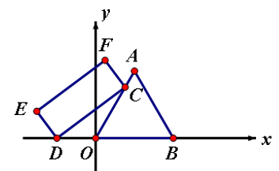

# Mathematics - 题目 2253

**ID**: bfa87af111d14721a0699725e11ec770
**年级**: Grade 9
**难度**: Hard
**题型**: Fill-in-the-blank

## 题目
如图，等边△AOB，点C是边AO所在直线上的动点，点D是x轴上的动点，在矩形CDEF中，CD=6，DE= $\sqrt {3}$ ，则OF的最小值为．​​​​​​​‌

## 解答

1. 解：取EF的中点G，连接DG、CD、OG，并以DG为半径以G为圆心作圆，
2. 
3. ∵在矩形CDEF中，CD=6，DE= $\sqrt {3}$ ，
4. ∴EG=FG=3，
5. ∴tan∠EGD= $\frac {\sqrt {3}}{3}$
6. ∴∠EGD=30°，DG=CG= $2\sqrt {3}$ ,
7. ∴∠CGD=120°，
8. ∵在等边△AOB中∠AOB=60°，
9. ∴∠AOD=120°，
10. ∴ ${\rm \frac {1}{2}\angle CGD+\angle COD=180{}^\circ}$ ，
11. ∴C、D、O和圆G上任意一点共圆，即点O在 ${\rm \odot G}$ 上，
12. ∴DG=OG= $2\sqrt {3}$ ，
13. 在△FGO中， ${\rm OG+FG\geqslant OF\geqslant OG-FG}$ ，
14. ∴ ${\rm 2\sqrt {3}+3\geqslant OF\geqslant 2\sqrt {3}-3}$ ，
15. ∴OF的最小值为 $2\sqrt {3}-3$ ．
16. 故答案为： $2\sqrt {3}-3$ ．

## 知识点

**中文**:
  - 三角形的外接圆
  - 点和圆的位置关系
  - 正切

**English**:
  - Circumcircle of Triangle
  - Point and Circle Relationship
  - Tangent

---
