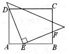

# Mathematics - 题目 1959

**ID**: 97a29bf616c64916bfc163a2bc0f3873
**年级**: Grade 9
**难度**: Hard
**题型**: Multiple-choice

## 题目
如图，在矩形ABCD中，AD=6，AB=10，一个三角形的直角顶点E是边AB上的一动点，一直角边过点D，另一直角边与BC交于F，若AE=x，BF=y，则y关于x的函数关系的图象大致为（      ）​​​​​​​‌

## 解答

1. 解：设AE=x，BF=y，则DE^{2}=6^{2}+x2，EF^{2}=（10-x）^{2}+y^{2}，DF^{2}=（6-y）^{2}+10^{2}；
2. ∵△DEF为直角三角形，
3. ∴DE^{2}+EF^{2}=DF^{2}，
4. 即6^{2}+x^{2}+（10-x）^{2}+y^{2}=（6-y）^{2}+10^{2}，
5. 解得 $y=-\frac {1}{6}x{^{2}}+\frac {5}{3}x=\frac {1}{6}(x-5){^{2}}+\frac {25}{6}$
6. 根据函数关系式可看出A中的函数图象与之对应．
7. 故答案为A.

## 知识点

**中文**:
  - 实际问题与二次函数

**English**:
  - Real-world Problems and Quadratic Functions

---
