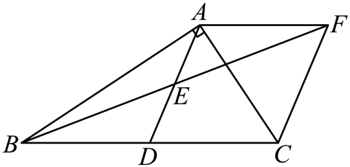

# Mathematics - 题目 1997

**ID**: 0278b3d2779d43709a8fae4e9208e4e4
**年级**: Grade 9
**难度**: Medium
**题型**: Calculation

## 题目
在 $Rt\Delta ABC$ 中， $\angle BAC=90{}\degree $ ， $D$ 是 $BC$ 的中点， $E$ 是 $AD$ 的中点，过点 $\mathrm{A}$ 作 $AF//BC$ 交 $BE$ 的延长线于点 $F$ ，连接 $CF$ .​​​​​​​‌（1）求证： $AF=BD$ .（2）求证：四边形 $ADCF$ 是菱形.

## 解答

1. （1）证明：如图， $\because AF//BC$ ，
2. $\therefore \angle AFE=\angle DBE$ ，
3. $\because \Delta ABC$ 是直角三角形， $AD$ 是 $BC$ 边上的中线， $E$ 是 $AD$ 的中点，
4. $\therefore AE=DE$ ， $BD=CD$ ，
5. 在 $\Delta AFE$ 和 $\Delta DBE$ 中，
6. $\begin{cases}\angle AFE=\angle DBE\\\angle FEA=\angle BED\\AE=DE\end{cases}$ ，
7. $\therefore ΔAFE\cong ΔDBE$ ；
8. $\therefore AF=BD$ ．
9. （2）由（1）知， $AF=BD$
10. $\because BD=CD$ ，
11. $\therefore AF=CD$ ，
12. $\because AF//BC$ ，
13. $\therefore $ 四边形 $ADCF$ 是平行四边形，
14. $\because \angle BAC=90{}\degree $ ， $D$ 是 $BC$ 的中点，
15. $\therefore AD=\frac {1}{2}BC=DC$ ，
16. $\therefore $ 四边形 $ADCF$ 是菱形.

## 知识点

**中文**:
  - 一组对边平行且相等的四边形是平行四边形
  - 菱形的判定
  - 全等三角形的判定与性质

**English**:
  - One Pair of Parallel and Equal Opposite Sides
  - Determination of Rhombuses
  - Determination and Properties

---
