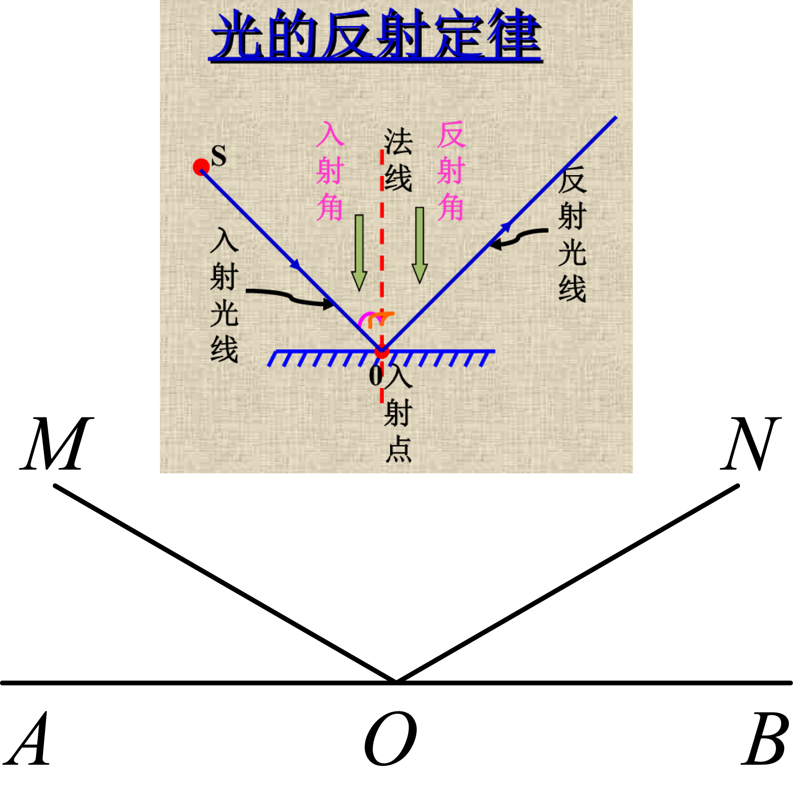
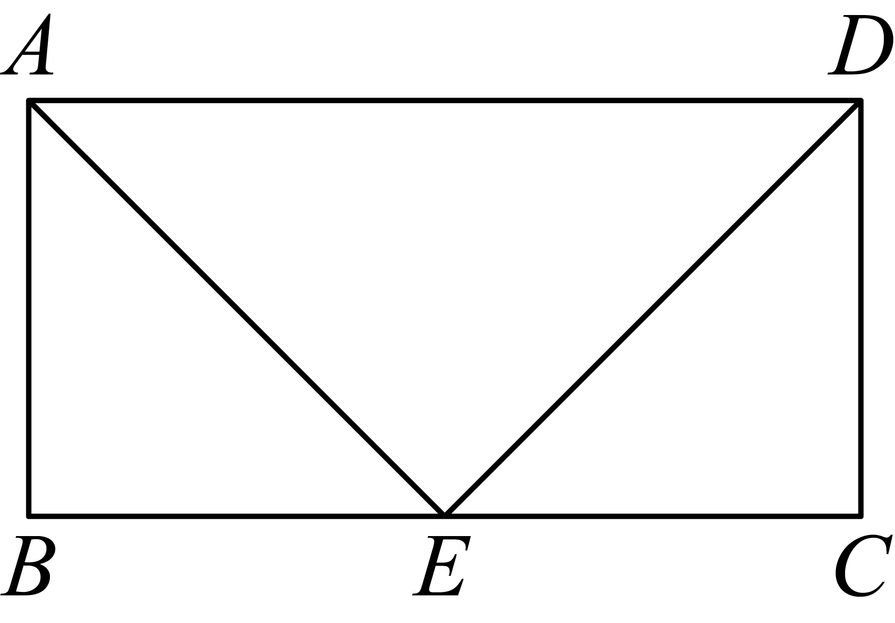
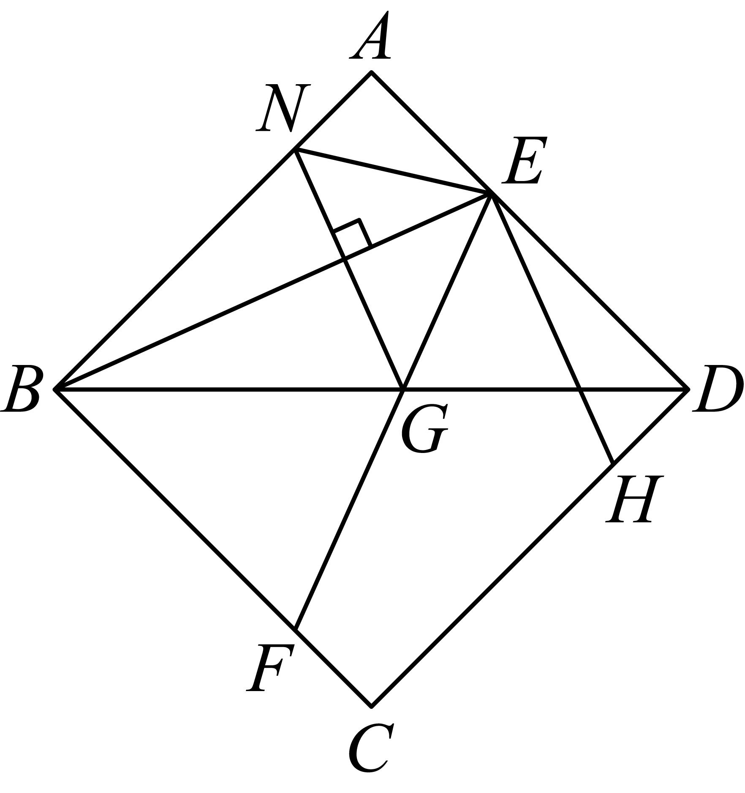

# Mathematics - 题目 376

**ID**: 04937878b857470fa304a5e450a14f45
**年级**: Grade 9
**难度**: Medium
**题型**: Calculation

## 题目
阅读理解：如图在物理光学中我们知道入射光线，反射光线和法线在同一平面内，入射光线、反射光线与法线的夹角分别叫做入射角和反射角，且入射角等于反射角那么入射光线、反射光线与平面镜的夹角我们就称之为镜面角如图中的 $\angle 1$ 与 $\angle 2$ ，易得 $\angle 1=\angle 2$定义：如图在线段 $AB$ 上取点O，以O为端点，在 $AB$ 的同侧引射线 $OM$ 与射线 $ON$ 若 $\angle AOM=\angle BON$ 则称锐角 $∠AOM$ 与锐角 $\angle BON$ 是一对镜面角实践感知：（1）如图在矩形 $ABCD$ 中，点E是 $BC$ 边中点，连接 $AE、BE$ ．求证： $\angle AEB$ 与 $\angle DEC$ 是镜面角；​​​​​​​‌应用探索（2）如图正方形 $ABCD$ 中，取 $AD$ 边上一点E，连接 $BE$ ，在 $BC$ 边上取点F，连接 $EF$ ， $EF=EB$ ，连接 $BD$ 交 $EF$ 于G，过点G作 $GN\bot BE$ 交 $AB$ 于N，连接 $EN$ ，再过点E作 $EH{\rm{/\mskip-4mu/}}NG$ 交 $CD$ 于H，若 $AE{^{2}}=AN\cdot AB$ ，请直接写出图中所有的镜面角（不另加辅助线）．

## 解答

1. 解：（1）∵四边形 $ABCD$ 是矩形，
2. $\therefore AB=CD$ ， $\angle B=\angle C=90{}\degree $ ，
3. ∵点E是 $BC$ 的中点，
4. $\therefore BE=CE$ ，
5. $\therefore △ABE≌△DCE\left ({{\rm{S}}{\rm{A}}{\rm{S}}}\right )$ ，
6. $\therefore \angle ABE=\angle DEC$ ，
7. $\therefore \angle AEB$ 与 $\angle DEC$ 是镜面角；
8. （2）∵四边形 $ABCD$ 是正方形，
9. ∴ $∠A=90{}\degree ，AD/\mskip-4mu/BC$ ， $\angle ABD=45{}\degree $ ，
10. ∴ $∠AEB=∠EBF，∠DEF=∠EFB$ ，
11. ∵ $EF=EB$ ，
12. ∴ $\angle EBF=\angle EFB$ ，
13. ∴ $\angle AEB=\angle DEF$ ，
14. ∴ $\angle AEB$ 与 $\angle DEF$ 是镜面角；
15. ∵ $AE{^{2}}=AN\cdot AB$ ，
16. ∴ $\frac {AE}{AB}=\frac {AN}{AE}$ ，
17. 又∵ $\angle A=\angle A$ ，
18. ∴ $\vartriangle AEN∽\vartriangle ABE$ ，
19. ∴ $∠AEN=∠ABE$ ，
20. ∵ $GN\bot BE$ ，
21. ∴ $∠ABE+∠BNG=90{}\degree $ ，
22. 又∵ $\angle AEN+\angle ANE=90{}\degree $ ，
23. ∴ $∠ANE=∠BNG$ ，
24. ∴ $\angle ANE$ 与 $\angle BNG$ 是镜面角；
25. ∵ $EH/\mskip-4mu/NG，NG⊥BE$ ，
26. ∴ $EH\bot BE$ ，
27. ∴ $\angle BEH=90{}\degree $ ，
28. ∴ $\angle DEH+\angle AEB=90{}\degree $ ，
29. 又∵ $\angle AEB+\angle ABE=90{}\degree $ ，
30. ∴ $∠DEH=∠ABE=∠AEN$ ，
31. ∴ $\angle AEN$ 与 $\angle DEH$ 是镜面角；
32. 设 $\angle ABE=x$ ，则 $∠EBG=∠ABD-∠ABE=45{}\degree -x，∠EBF=∠EFB=∠ABC-∠ABE=90{}\degree -x$ ，
33. ∴ $∠BEF=180{}\degree -∠EBF-∠EFB=2x$ ，
34. ∴ $∠DGE=∠EBG+∠BEG=45{}\degree +x$ ，
35. ∵ $GN\bot BE$ ，
36. ∴ $∠BGN=90{}\degree -∠EBG=45{}\degree +x$ ，
37. ∴ $∠DGE=∠BGN$ ，
38. ∴ $\angle DGE$ 与 $\angle BGN$ 是镜面角；
39. 综上所述，图中的镜面角有： $\angle AEB$ 与 $\angle DEF$ ， $\angle ANE$ 与 $\angle BNG$ ， $\angle AEN$ 与 $\angle DEH$ ， $\angle DGE$ 与 $\angle BGN$ ．

## 知识点

**中文**:
  - 正方形的性质
  - 矩形的性质
  - 相似三角形的判定与性质综合

**English**:
  - Properties of Squares
  - Properties of Rectangles
  - Determination and Properties

---
