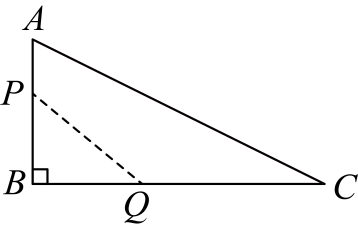

# Mathematics - 题目 2551

**ID**: 0a375a066304499a82b6cba9e01cf5de
**年级**: Grade 9
**难度**: Medium
**题型**: Calculation

## 题目
如图，在 $\vartriangle ABC$ 中， $\angle B=90{}\degree $ ， $AB=12{\rm{c}}{\rm{m}}$ ， $BC=24{\rm{c}}{\rm{m}}$ ，动点 $P$ 从点 $\mathrm{A}$ 开始沿边 $AB$ 向点 $B$ 以 $2{\rm{c}}{\rm{m}}/{\rm{s}}$ 的速度移动，动点 $Q$ 从点 $B$ 开始沿边 $BC$ 向点 $C$ 以 ${{4}}{\rm{c}}{\rm{m}}/{\rm{s}}$ 的速度移动，如果 $P$ ， $Q$ 两点分别从 $\mathrm{A}$ ， $B$ 两点同时出发，设运动时间为 $x{\rm{s}}$ ．(1)用含 $x$ 的式子表示： $BP=$ _ ${\rm{c}}{\rm{m}}$ ， $S{{}_{\vartriangle PBQ}}=$ _ ${\rm{c}}{\rm{m}}{^{2}}$ ， $S{{}_{四边形APQC}}=$ _ ${\rm{c}}{\rm{m}}{^{2}}$ ；​​​​​​​‌(2)当 $\vartriangle PBQ$ 的面积为 $32{\rm{c}}{\rm{m}}{^{2}}$ 时，求运动时间；(3)四边形 $APQC$ 的面积能否等于 $172{\rm{c}}{\rm{m}}{^{2}}$ ？若能，求出运动的时间；若不能，说明理由．

## 解答

1. （1）∵ $P$ 从点 $\mathrm{A}$ 开始沿边 $AB$ 向点 $B$ 以 $2{\rm{c}}{\rm{m}}/{\rm{s}}$ 的速度移动，
2. ∴ $AP=2x{\rm{c}}{\rm{m}}$ ，
3. ∵ $AB=12{\rm{c}}{\rm{m}}$ ，
4. ∴ $BP=\left ({12-2x}\right ){\rm{c}}{\rm{m}}$ ，
5. ∵动点 $Q$ 从点 $B$ 开始沿边 $BC$ 向点 $C$ 以 $4{\rm{c}}{\rm{m}}/{\rm{s}}$ 的速度移动，
6. ∴ $BQ=4x{\rm{c}}{\rm{m}}$ ，
7. ∵ $\angle B=90{}\degree $ ，
8. ∴ $S{{}_{\vartriangle PBQ}}=\frac {1}{2}\times PB\times BQ$ ，
9. ∴ $S{{}_{\vartriangle PBQ}}=\frac {1}{2}\times \left ({12-2x}\right )\times 4x=-4x{^{2}}+24x$ ，
10. ∵ $S{{}_{四边形APQC}}=S{{}_{\vartriangle ABC}}-S{{}_{\vartriangle PBQ}}$ ，
11. ∴ $S{{}_{四边形APQC}}=\frac {1}{2}\times AB\times BC-\left ({-4x{^{2}}+24x}\right )$ ，
12. ∴ $S{{}_{四边形APQC}}=4x{^{2}}-24x+144$
13. （2）由（1）得， $S{{}_{\vartriangle PBQ}}=-4x{^{2}}+24x$
14. ∴当 $\vartriangle PBQ$ 的面积为 $32{\rm{c}}{\rm{m}}{^{2}}$ 时，
15. ∴ $S{{}_{\vartriangle PBQ}}=-4x{^{2}}+24x=32$ ，
16. ∴ $x{{}_{1}}=2$ ， $x{{}_{2}}=4$ ，
17. ∴当 $\vartriangle PBQ$ 的面积为 $32{\rm{c}}{\rm{m}}{^{2}}$ 时，求运动时间为： $x=2{\rm{s}}$ 或 $x=4{\rm{s}}$ ．
18. （3）由（1）得， $S{{}_{四边形APQC}}=4x{^{2}}-24x+144$ ，
19. 当四边形 $APQC$ 的面积等于 $172{\rm{c}}{\rm{m}}{^{2}}$ ， $4x{^{2}}-24x+144=172$ ，
20. ∴ $x{{}_{1}}=7$ ， $x{{}_{2}}=-1$ （舍），
21. ∵ $0\leqslant x\leqslant 6$ ，
22. ∴四边形 $APQC$ 的面积不能等于 $172{\rm{c}}{\rm{m}}{^{2}}$ 时．

## 知识点

**中文**:
  - 几何问题

**English**:
  - Geometry Problems

---
