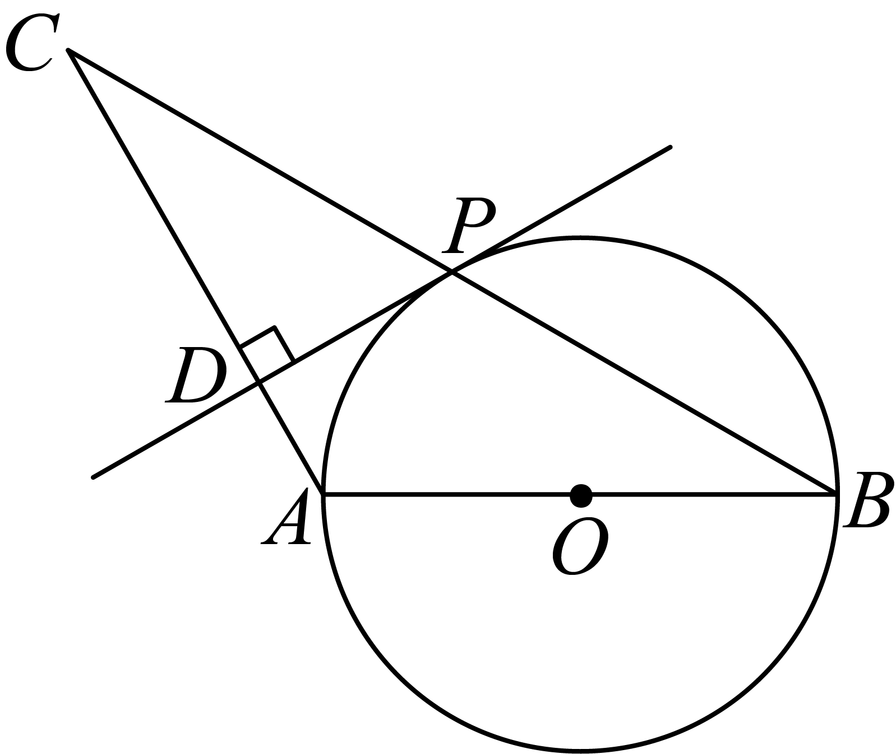

# Mathematics - 题目 2529

**ID**: 0cde0e5bf0014c21bb3041b1d307388a
**年级**: Grade 9
**难度**: Medium
**题型**: Calculation

## 题目
已知：如图，⊿ABC中，AB=AC，以AB为直径的⊙O交BC于点P，PD⊥AC于点D．（1）求证：PD是⊙O的切线．（2）若 ${\rm ∠\mathit{CAB}=120°，\mathit{AB}=2}$ ，求BC的长．​​​​​​​‌

## 解答

1. (1)证明：连接OP，
2. ∵AB=AC
3. ∴ ${\rm ∠\mathit{C}=∠\mathit{B}}$
4. ∵OP=OB
5. ∴ ${\rm ∠\mathit{OPB}=∠\mathit{B}}$
6. ∴ ${\rm ∠\mathit{C}=∠\mathit{OPB}}$
7. ∴OP∥AC
8. ∴ ${\rm ∠\mathit{OPD}=∠\mathit{PDC}}$
9. ∵PD⊥AC于点D
10. ∴ ${\rm ∠\mathit{PDC}=90°}$
11. ∴ ${\rm ∠\mathit{OPD}=90°}$ ，
12. 即：OP⊥PD
13. ∵OP为⊙O半径
14. ∴PD是 $\odot {\rm \mathit{O}}$ 切线
15. (2)连接AP.
16. ∵AB为⊙O直径
17. ∴ ${\rm ∠\mathit{APB}=90°}$ ,即：AP⊥BC
18. ∵AB=AC，∠BAC=120°
19. ∴ ${\rm ∠\mathit{C}=∠\mathit{B}=30°,\mathit{BP}=\mathit{PC}=}\frac {1}{2}{\rm \mathit{BC}}$
20. ∵在Rt△APB中，∠B=30°
21. ∴ ${\rm \mathit{AP}=}\frac {1}{2}{\rm \mathit{AB}=1}$
22. ∴ ${\rm \mathit{BP}=}\sqrt {AB{^{2}}-AP{^{2}}}=\sqrt {2{^{2}}-1{^{2}}}=\sqrt {3}$
23. ∴ ${\rm \mathit{BC}=2\mathit{BP}=2}\sqrt {3}$
24. 

## 知识点

**中文**:
  - 切线的判定定理
  - 含30度角的直角三角形
  - 圆周角定理及推论

**English**:
  - Tangent Determination Theorem
  - Right Triangle with 30° Angle
  - Inscribed Angle Theorem

---
