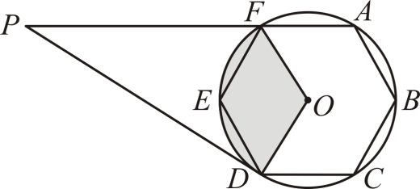

# Mathematics - 题目 1541

**ID**: 18545858092b411fbfda6b144796d532
**年级**: Grade 9
**难度**: Medium
**题型**: Calculation

## 题目
如图，正六边形 $ABCDEF$ 为 $\odot O$ 的内接正六边形，过点D作 $\odot O$ 的切线，交 $AF$ 的延长线于点P， $\odot O$ 的半径为6，连接 $OD$ ， $OF$ ．(1)求 $S{{}_{阴影}}$ ；​​​​​​​‌(2)连接 $DF$ ，试判断 $DF$ 和 $AP$ 有什么特殊位置关系，并说明理由．

## 解答

1. （1）解：连接 $OE$ ，
2. 
3. ∵正六边形 $ABCDEF$ 为 $\odot O$ 的内接正六边形，
4. ∴ $\angle EOF=\angle DOE=60{}^\circ $ ，
5. ∴ $\angle DOF=120{}^\circ $ ，
6. ∴ $S{{}_{阴影}}=\frac {120{\rm{π}}\times 6{^{2}}}{360}=12{\rm{π}}$ ；
7. （2） $DF\bot AP$ ，理由如下，连接 $OA$ ，
8. 
9. 由题意可得，点A，O，D共线，即 $AD$ 为 $\odot O$ 的直径，
10. ∴ $\angle DFA=90{}^\circ $ ，
11. ∴ $DF\bot AP$ ．

## 知识点

**中文**:
  - 扇形面积的计算
  - 正多边形和圆

**English**:
  - Sector Area Calculation
  - Regular Polygons and Circles

---
