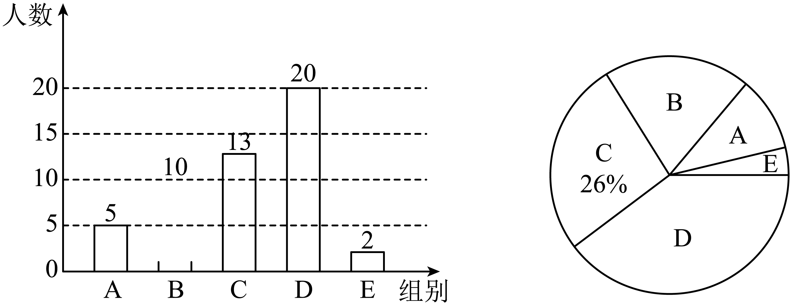

# Mathematics - 题目 3971

**ID**: 18998838c20e45758903be99a9d18428
**年级**: Grade 9
**难度**: Medium
**题型**: Calculation

## 题目
为了解学生完成书面作业所用时间的情况，进一步优化作业管理，某中学从全校学生中随机抽取部分学生，对他们一周平均每天完成书面作业的时间t（单位：分钟）进行调查．将调查数据进行整理后分为五组：A组“ $0<t\leqslant 45$ ”；​​​​​​​‌B组“ $45<t\mathrm{\leqslant }60$ ”；C组“ $60<t\leqslant 75$ ”；D组“ $75<t\leqslant 90$ ”；E组“ $t>90$ ”．现将调查结果绘制成如下两幅不完整的统计图．根据以上信息，解答下列问题：(1)这次调查的样本容量是，请补全条形统计图；(2)在扇形统计图中，A组对应的圆心角的度数是${}^\circ $ ，本次调查数据的中位数落在组内；(3)若该中学有2000名学生，请你估计该中学一周平均每天完成书面作业不超过90分钟的学生有多少人？

## 解答

1. （1）解：由题意知，样本容量为 $\frac {13}{26％}=50$ ，
2. B组人数为 $50-5-13-20-2=10$ （人），
3. 补全条形统计图如下：
4. 
5. （2）解：由题意知，在扇形统计图中，A组的圆心角为 $360{}^\circ \times \frac {5}{50}=36{}^\circ $ ，
6. ∵样本容量为50，
7. ∴将数据排序后，第25个和第26个数据的平均数为中位数，
8. ∵ $5+10=15$ ， $5+10+13=28$ ，
9. ∴本次调查数据的中位数落在 $C$ 组内，
10. 故答案为： $36{}^\circ $ ， $C$ ；
11. （3） $2000\times \frac {5+10+13+20}{50}=1920$ （人）,
12. 答：估计该中学一周平均每天完成书面作业不超过90分钟的学生有1920人．
13. 【点睛】本题考查了条形统计图与扇形统计图，圆心角，中位数，用样本估计总体等知识．解题的关键在于从统计图中获取正确的信息．

## 知识点

**中文**:
  - 总体、个体、样本、样本容量
  - 用样本估计总体
  - 条形统计图
  - 扇形统计图

**English**:
  - Population, Individual, Sample, Sample Size
  - Estimating Population from Sample
  - Bar Charts
  - Pie Charts

---
