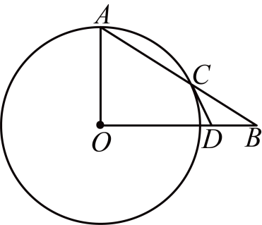

# Mathematics - 题目 3925

**ID**: 1ada5f4462524140afe4cf0ca02eacf1
**年级**: Grade 9
**难度**: Medium
**题型**: Calculation

## 题目
如图，在 ${\rm{R}}{\rm{t}}\vartriangle OAB$ 中， $\angle AOB=90{}\degree $ ，以点 $O$ 为圆心， $OA$ 为半径的圆交 $AB$ 于点 $C$ ，点 $D$ 在边 $OB$ 上，且 $DC=DB$ ．（1）判断直线 $CD$ 与 $\odot O$ 的位置关系，并说明理由．（2）已知 ${\tan}∠DOC=\frac {7}{24}$ ， $AB=40$ ，求 $\odot O$ 的半径．​​​​​​​‌

## 解答

1. （1）解：直线 $CD$ 与 $\odot O$ 相切，
2. 理由如下：如图，连接 $OC$ ，
3. 
4. ， $\because OA=OC$ ， $CD=BD$ ，
5. $\therefore \angle A=\angle ACO$ ， $\angle B=\angle DCB$ ，
6. $\because \angle AOB=90{}\degree $ ，
7. $\therefore \angle A+\angle B=90{}\degree $ ，
8. $\therefore \angle ACO+\angle DCB=90{}\degree $ ，
9. $\therefore \angle OCD=90{}\degree $ ，
10. $\therefore OC\bot CD$ ，
11. $\because OC$ 是半径，
12. $\therefore $ 直线 $CD$ 与 $\odot O$ 相切；
13. （2）解：如图，连接 $OC$ ，
14. ，
15. 由（1）可得： $\angle OCD=90{}\degree $ ，
16. $\because {\tan}∠DOC=\frac {7}{24}$ ，
17. $\therefore $ 设 $CD=7x$ ，则 $BD=CD=7x$ ， $OA=OC=24x$ ，
18. $\therefore OD=\sqrt {OC{^{2}}+CD{^{2}}}=25x$ ，
19. $\therefore OB=OD+BD=25x+7x=32x$ ，
20. $\because AB{^{2}}=AO{^{2}}+OB{^{2}}$ ，
21. $\therefore 40{^{2}}={\left({24x}\right)^{2}}+{\left({32x}\right)^{2}}$ ，
22. 解得： $x=1$ ，
23. $\therefore AO=OC=24$ ，
24. $\therefore $  $\odot O$ 的半径为 $24$ ．

## 知识点

**中文**:
  - 切线的判定定理
  - 勾股定理
  - 解直角三角形

**English**:
  - Tangent Determination Theorem
  - Pythagorean Theorem
  - Solving Right Triangles

---
