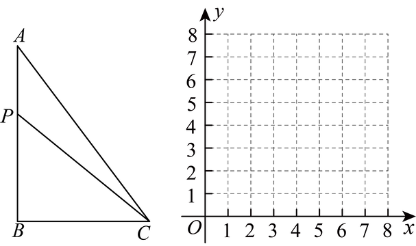

# Mathematics - 题目 1425

**ID**: 1b5e5a4fba9a4109a0351d7de2b953bd
**年级**: Grade 9
**难度**: Medium
**题型**: Calculation

## 题目
如图， $\vartriangle ABC$ 中， $\angle B=90{}\degree $ ， $BC=3$ ， $AB=4$ ．动点 $P$ 以每秒2个单位长度的速度从点 $B$ 出发向点 $\mathrm{A}$ 运动，到达点 $\mathrm{A}$ 后，又以每秒1个单位长度的速度返回点 $B$ ，点 $P$ 回到点 $B$ 时停止运动．连接 $CP$ ，设点 $P$ 运动时间为 $x$ 秒， $\vartriangle BCP$ 的面积为 $y{{}_{1}}$ ， $AB$ 的长度与 $x$ 的比为 $y{{}_{2}}$ ．（1）请直接写出 $y{{}_{1}}$ ， $y{{}_{2}}$ 关于 $x$ 的函数表达式并注明自变量 $x$ 的取值范围；（2）在给定的平面直角坐标系中画出函数 $y{{}_{1}}$ ， $y{{}_{2}}$ 的图象；请分别写出函数 $y{{}_{1}}$ ， $y{{}_{2}}$ 的一条性质；（3）结合函数图象，直接写出当 $y{{}_{1}}>y{{}_{2}}$ 时， $x$ 的取值范围．（近似值保留一位小数，误差不超过 $0.​​​​​​​‌2$ ）

## 解答

1. （1）解：由题意可得： $BC=3$ ， $AB=4$ ，
2. 当 $0\leqslant x\leqslant 2$ 时， $BP=2x$ ， $AP=4-2x$ ，
3. ∵ $\vartriangle BCP$ 的面积为 $y{{}_{1}}$ ，
4. ∴ $y{{}_{1}}=\frac {1}{2}BC\cdot BP=\frac {1}{2}\times 3\times 2x=3x$ ，
5. 当 $2<x\leqslant 6$ 时，则 $AP=x-2$ ， $BP=4-\left ({x-2}\right )=6-x$ ，
6. ∴ $y{{}_{1}}=\frac {1}{2}BC\cdot BP=\frac {1}{2}\times 3\times \left ({6-x}\right )=9-\frac {3}{2}x$ ，
7. 综上： $y{{}_{1}}=\begin{cases}\begin{matrix}3x\left ({0\leqslant x\leqslant 2}\right )\\9-\frac {3}{2}x\left ({2<x\leqslant 6}\right )\end{matrix}\end{cases}$ ；
8. ∵ $AB$ 的长度与 $x$ 的比为 $y{{}_{2}}$ ．
9. ∴ $y{{}_{2}}=\frac {4}{x}\left ({0<x\leqslant 6}\right )$ ；
10. （2）解：如图， $y{{}_{1}}$ ， $y{{}_{2}}$ 的图象如下：
11. ；
12. 当 $0\leqslant x\leqslant 2$ ， $y{{}_{1}}$ 随 $x$ 的增大而增大，当 $2<x\leqslant 6$ 时， $y{{}_{1}}$ 随 $x$ 的增大而减小，
13. 当 $0<x\leqslant 6$ 时， $y{{}_{2}}$ 随 $x$ 的增大而减小．
14. （3）解：由图象可得：当 $y{{}_{1}}>y{{}_{2}}$ 时，图象在 $N,Q$ 之间；
15. ∴ $1.1<x<5.5$ ；

## 知识点

**中文**:
  - 从函数的图象获取信息
  - 动点问题的函数图象
  - 反比例函数综合

**English**:
  - Extracting Information from Graphs
  - Graphs of Moving Point Problems
  - Comprehensive Inverse Proportionality Problems

---
