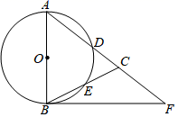

# Mathematics - 题目 2211

**ID**: 1d87cc7bba4e4e02b7133e9c82295eba
**年级**: Grade 9
**难度**: Medium
**题型**: Calculation

## 题目
如图，在△ABC中，AB＝AC，以AB为直径的⊙O分别交AC、BC于点D、E，点F在AC的延长线上，且∠CBF＝ $\frac {1}{2}$ ∠CAB．（1）求证：直线BF是⊙O的切线；​​​​​​​‌（2）若AB＝5，sin∠BAD＝ $\frac {4}{5}$ ，求AD的长；（3）试探究FB、FD、FA之间的关系，并证明．

## 解答

1. 解：(1)证明：连结 $AE$ .
2. 
3. ∵ $AB$ 是 $\odot O$ 的直径
4. ∴ $\angle AEB=90{}^\circ $
5. ∴ $\angle BAE+\angle ABE=90{}^\circ $
6. ∵ $AB=AC$             ∴ $\angle BAE=\frac {1}{2}\angle CAB$
7. ∵ $\angle CBF=\frac {1}{2}\angle CAB             $ ∴ $\angle BAE=\angle CBF$
8. ∴ $\angle CBF+\angle ABE=90{}^\circ ,$ ,即 $\angle ABF=90{}^\circ $
9. ∴ $AB\bot BF$
10. ∴直线 ${\rm{B}}{\rm{F}}$ 是 $\odot O$ 的切线.
11. （2）连接 $BD$ ，则 $\vartriangle ABD$ 为直角三角形.
12. ∴ ${\rm{s}}{\rm{i}}{\rm{n}}\angle BAD=\frac {BD}{AB}$    ∴ $BD=AB{\rm{s}}{\rm{i}}{\rm{n}}\angle BAD=5\times \frac {4}{5}=4$
13. 由勾股定理可得 $AD=3$ ;
14. （3） $FB²=FD·FA$
15. 证明：∵ $\angle F=\angle F，\angle ABF=\angle BDF$
16. ∴ $\vartriangle ABF∽\vartriangle BDF$
17. ∴ $\frac {FB}{FA}=\frac {FD}{FB}$
18. ∴ $FB²=FD·FA$

## 知识点

**中文**:
  - 圆周角定理及推论
  - 相似三角形的判定与性质综合
  - 解直角三角形

**English**:
  - Inscribed Angle Theorem
  - Determination and Properties
  - Solving Right Triangles

---
