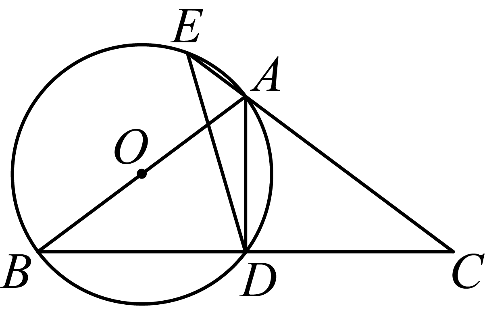

# Mathematics - 题目 3191

**ID**: 1ea09d44f3644520a1dc61ac16ba8dc7
**年级**: Grade 9
**难度**: Medium
**题型**: Calculation

## 题目
如图， $\vartriangle ABC$ 中， $AB=AC{\rm \mathit{．}}$ 以 $AB$ 为直径作 $\odot O{\rm \mathit{，}}$ 交 $BC$ 边于点D，交 $CA$ 的延长线于点E，连接 $AD$ ， $DE$ ．（1）求证： $BD=CD$ ；​​​​​​​‌（2）若 $AB=5$ ， $DE=4$ ，求 $AD$ 的长．

## 解答

1. （1）证明：∵ $AB$ 为 $\odot O$ 直径，
2. ∴ $\angle ADB=90{}\degree $ ，即 $AD⊥BC$ ，
3. ∵ $AB=AC$ ，
4. ∴ $BD=CD$ ．
5. （2）解：∵ $AB=AC$ ，
6. ∴ $\angle B=\angle C$ ，
7. ∵ $\angle B=\angle E$ ，
8. ∴ $\angle E=\angle C$ ，
9. ∵ $DE=4$ ，
10. ∴ $CD=DE=4$ ，
11. 由（1）可得： $BD=CD=4$ ， $AD⊥BC$ ，
12. ∵ $AB=5$ ，
13. ∴ $AD=\sqrt {AB{^{2}}-BD{^{2}}}=\sqrt {5{^{2}}-4{^{2}}}=3$ ．

## 知识点

**中文**:
  - 圆周角定理及推论

**English**:
  - Inscribed Angle Theorem

---
