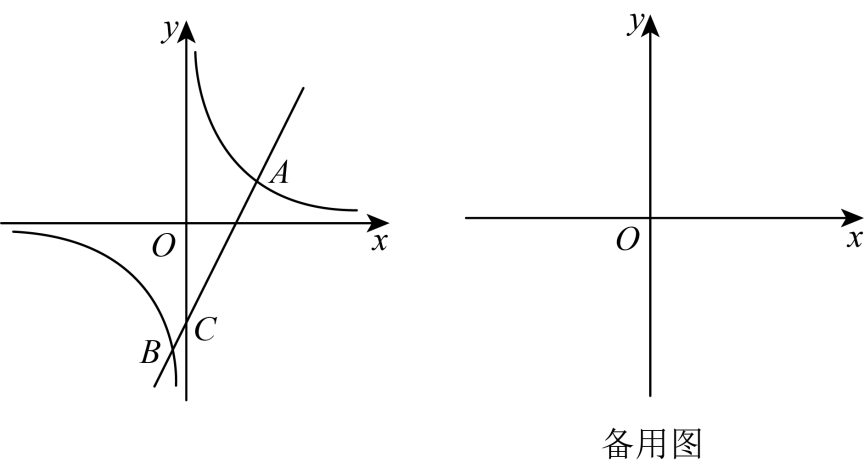

# Mathematics - 题目 2237

**ID**: 22735934b919453bb8590b847b9b165d
**年级**: Grade 9
**难度**: Medium
**题型**: Calculation

## 题目
如图，在平面直角坐标系 $xOy$ 中，直线 $y=kx-3(k>0)$ 与反比例函数 $y=\frac {k}{x}$ 的图象相交于A，B两点（点A在点B的右侧），与y轴相交于点C．(1)当 $k=2$ 时．（ⅰ）分别求A，B两点的坐标；​​​​​​​‌（ⅱ）P为x轴上一动点，当 $\angle APC=\angle ABP$ 时，求点P的坐标；(2)取点 $M(0,1)$ ，连接 $AM{\rm{，}}BM$ ，当 $\angle AMB=90{}^\circ $ 时，求k的值．

## 解答

1. （1）解：（ⅰ）当 $k=2$ 时，直线解析式为 $y=2x-3$ ，反比例函数解析式为 $y=\frac {2}{x}$ ，
2. 解方程组： $\begin{cases}y=2x-3\\y=\frac {2}{x}\end{cases}$ ，解得 $\begin{cases}x=-\frac {1}{2}\\y=-4\end{cases}$ 或 $\begin{cases}x=2\\y=1\end{cases}$ ，
3. ∴ $A(2,1)，B\left ({-\frac {1}{2},-4}\right )$ ；
4. （ⅱ）如图，对于 $y=2x-3$ ，令 $x=0$ ，得 $y{\rm{=}}-{\rm{3}}$ ，
5. ∴ $C(0,-3)$ ，
6. ∴ $AC=\sqrt {2{^{2}}+4{^{2}}}=2\sqrt {5}$ ， $AB=\sqrt {{\left({\frac {5}{2}}\right)^{2}}+5{^{2}}}=\frac {5\sqrt {5}}{2}$ ；
7. ∵ $\angle APC=\angle ABP$ ， $\angle PAC=\angle BAP$ ，
8. ∴ $\vartriangle APC∽\vartriangle ABP$ ，
9. ∴ $\frac {PA}{AB}=\frac {AC}{PA}$ ，
10. ∴ $PA{^{2}}=AB\cdot AC$ ；
11. 设点 $P(x,0)$ ，则 $PA{^{2}}=(x-2){^{2}}+1$ ，
12. ∴ $(x-2){^{2}}+1=\frac {5\sqrt {5}}{2}\times 2\sqrt {5}$ ，
13. 解得： $x=2\pm 2\sqrt {6}$ ，
14. ∴点P的坐标为 $(2-2\sqrt {6},0)$ 或 $(2+2\sqrt {6},0)$ ；
15. 
16. （2）解：联立方程组：  $\begin{cases}y=kx-3\\y=\frac {k}{x}\end{cases}$ ，消去y得 $kx{^{2}}-3x-k=0$ ，
17. ∴ $x{{}_{A}}+x{{}_{B}}=\frac {3}{k}$ ， $x{{}_{A}}\cdot x{{}_{B}}=-1$ ；
18. 设 $A\left ({a,\frac {k}{a}}\right )$ ，则 $B\left ({-\frac {1}{a},-ak}\right )$ ，
19. ∴ $a-\frac {1}{a}=\frac {3}{k}$ ；
20. 如图，过A作 $AF\bot y$ 轴于点F，过B作 $BE⊥y$ 轴于点E，
21. ∵ $\angle AFM=\angle AMB=\angle BEM=90{}^\circ $ ，
22. ∴ $\angle FAM+\angle AMF=\angle AMF+\angle BME$ ，
23. ∴ $\angle FAM=\angle BME$ ，
24. ∴ $\vartriangle AMF∽\vartriangle MBE$ ，
25. ∴ $\frac {AF}{ME}=\frac {MF}{BE}$ ，
26. 即 $AF\cdot BE=ME\cdot MF$ ,
27. ∵ $AF=a，BE=\frac {1}{a}，ME=1+ak，MF=1-\frac {k}{a}$ ，
28. ∴ $a\times \frac {1}{a}=(1+ak)\left ({1-\frac {k}{a}}\right )$ ，
29. ∴ $k\left ({k+\frac {1}{a}-a}\right )=0$ ；
30. ∵ $k>0$ ，
31. ∴ $k+\frac {1}{a}-a=0$ ，
32. ∵ $a-\frac {1}{a}=\frac {3}{k}$ ，
33. ∴ $\frac {3}{k}=k$ ，
34. 即 $k=\sqrt {3}$ ．
35. 

## 知识点

**中文**:
  - 一元二次方程根与系数的关系
  - 反比例函数的性质
  - 相似三角形的判定与性质综合

**English**:
  - Relationship between Roots and Coefficients (Vieta's Formulas)
  - Properties of Inverse Proportionality Functions
  - Determination and Properties

---
