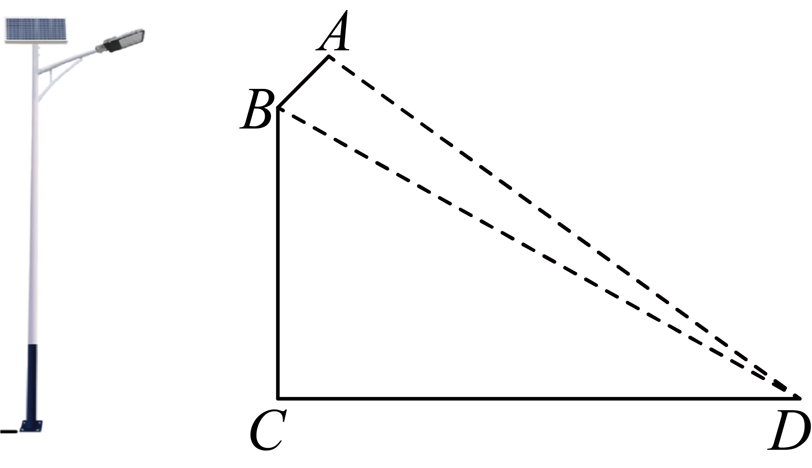

# Mathematics - 题目 746

**ID**: 24128515d4ac4675838689d75c83ff09
**年级**: Grade 9
**难度**: Medium
**题型**: Calculation

## 题目
某数学兴趣小组测市政新增路灯高度的活动记录如下：活动记录表测量目标测量市政新增路灯高度测量工具测倾器，皮尺等测量示意图及测量方法说明：新增路灯款式为折线 $A-B-C$ ， $AB$ 为灯杆， $BC$ 为立柱，已知 $\angle ABC=135{}\degree $ ．测量方法：在点 $D$ 处架设测倾器，分别测量 $\angle BDC$ 和 $∠ADC$ 的角度．备注：测倾器的高度忽略不计，点 $\mathrm{A}$ 、 $B$ 、 $C$ 、 $D$ 在同一平面， $BC\bot CD$ ．测量数据$\angle BDC=30{}\degree $ ， $\angle ADC=37{}\degree $ ， $CD=14$ 米．请根据上表中的测量数据，求出路灯的高度（点 $\mathrm{A}$ 到地面 $CD$ 的距离）．（结果精确到 $0.​​​​​​​‌1$ 米，参考数据： $\sqrt {3}=1.73$ ， $\sin 37{}\degree =\frac {3}{5}$ ， ${\cos}37{}\degree =\frac {4}{5}$ ， ${\tan}37{}\degree =\frac {3}{4}$ ）

## 解答

1. 如图，过点 $\mathrm{A}$ 作 $AE\bot CD$ 于点 $E$ ，过点 $B$ 作 $BF\bot AE$ 于点 $F$ ．
2. 
3. $\because $ 在 ${\rm{R}}{\rm{t}}△BCD$ 中， $\angle C=90{}\degree $ ， $\angle BDC=30{}\degree $ ， $CD=14$ 米，
4. $\therefore $  $BC=\frac {\sqrt {3}}{3}CD=\frac {14\sqrt {3}}{3}$ 米．
5. $\because $  $\angle C=90{}\degree $ ， $AE\bot CD$ 于点 $E$ ， $BF\bot AE$ 于点 $F$ ，
6. $\therefore $  $\angle C=\angle FEC=\angle BFE=90{}\degree $ ，
7. $\therefore $ 四边形 $BCEF$ 是矩形，
8. $\therefore $  $EF=BC=\frac {14\sqrt {3}}{3}$ 米， $BF=CE$ ， $\angle CBF=90{}\degree $ ．
9. $\because $  $\angle ABC=135{}\degree $
10. $\therefore \angle ABF=\angle ABC-\angle CBF=135{}\degree -90{}\degree =45{}\degree $
11. $\because \angle AFB=90{}\degree $ ，
12. $\therefore \angle ABF=\angle BAF=45{}\degree $ ，
13. $\therefore BF=AF$ ，
14. 设 $AF=x$ ，则 $BF=AF=CE=x$ ，
15. $\therefore $  $AE=AF+EF=x+\frac {14\sqrt {3}}{3}$ ， $DE=CD-CE=14-x$ ．
16. $\because $ 在 ${\rm{R}}{\rm{t}}△AED$ 中， $\angle ADE=37{}\degree $ ，
17. $\therefore $  ${\tan}\angle ADE={\tan}37{}\degree =\frac {3}{4}$ ，
18. $\therefore $  $\frac {3}{4}=\frac {x+\frac {14\sqrt {3}}{3}}{14-x}$ ，
19. 解得 $x=6-\frac {8\sqrt {3}}{3}$ ，
20. $\therefore $  $AE=x+\frac {14\sqrt {3}}{3}=6+2\sqrt {3}\approx 9.5$ 米．
21. $\therefore $ 该路灯的高度约为 $9.5$ 米．

## 知识点

**中文**:
  - 解直角三角形
  - 解直角三角形的实际应用

**English**:
  - Solving Right Triangles
  - Applications of Solving Right Triangles

---
