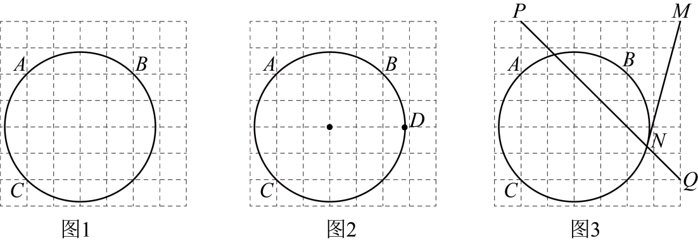

# Mathematics - 题目 1800

**ID**: 27fb7ba201164fafae7fcff57ee7e509
**年级**: Grade 9
**难度**: Medium
**题型**: Calculation

## 题目
图1、图2、图3均是7×7的正方形网格，每个小正方形的顶点称为格点，每个小正方形的边长均为 ${\rm 1，}\odot O$ 经过格点A，B，C．(1)操作：只用无刻度的直尺，在给定的网格中，按要求画图，保留作图痕迹，不要求写画法．步骤一：在图1、图2、图3中画出圆心O．（直接点出即可）步骤二：在图1中画 $\odot O$ 的切线 $BE$ ．步骤三：图2中，点D为 $\odot O$ 与网格线的交点，在 $\odot O$ 上画点F，使F是 $\overset{\frown}{{CD}}$ 的中点．(2)探究：①求 $\overset{\frown}{{CF}}$ 的长度（结果保留π）．②图3中，点P，Q，M均在格点上，连接 $PQ$ 与 $\odot O$ 交于点N，连接 $MN$ ．直接写出 $MN$ 的长．​​​​​​​‌

## 解答

1. (1)解：圆心O，切线 $BE{\rm ，\mathit{F}}$ 是 $\overset{\frown}{{CD}}$ 的中点，如图所示：
2. 
3. (2)解：①由图2可得， $\mathrm{△}POC$ 是等腰直角三角形，则 $\mathrm{∠}POC=45\mathrm{°}$ ，
4. ∴ $\angle DOC=135{}\degree $ ，
5. ∵F是 $\overset{\frown}{{CD}}$ 的中点，
6. ∴ $\angle FOC=\frac {1}{2}\angle DOC=67.5{}\degree $ ，
7. ∵半径 $OB=OC=OF=\sqrt {2{^{2}}+2{^{2}}}=2\sqrt {2}$ ，
8. ∴ $\overset{\frown}{{CF}}$ 的长度为 $\frac {67.5{}\degree \cdot π2\sqrt {2}}{180{}\degree }=\frac {3\sqrt {2}π}{4}$ ；
9. ②连接 $BM$ ，则 $B$ ， $C$ ， $M$ 三点共线，设 $CM$ 与 $PQ$ 交于点 $G$ ，连接 $GO$ ，
10. 由图可得 $MP=MQ=6$ ， $GP=GQ=GM=3\sqrt {2}$ ， $OG=\sqrt {2}$ ， $OB=ON=2\sqrt {2}$ ，
11. ∴ $CM\bot PQ$ ，
12. ∴ $GN=\sqrt {ON{^{2}}-OG{^{2}}}=\sqrt {{\left({2\sqrt {2}}\right)^{2}}-{\left({\sqrt {2}}\right)^{2}}}=\sqrt {6}$ ，
13. ∴ $MN=\sqrt {GN{^{2}}+MG{^{2}}}=\sqrt {{\left({3\sqrt {2}}\right)^{2}}+{\left({\sqrt {6}}\right)^{2}}}=2\sqrt {6}$ ．

## 知识点

**中文**:
  - 切线的性质定理
  - 垂径定理及其推论
  - 弧、弦、圆心角的关系
  - 弧长公式

**English**:
  - Tangent Properties Theorem
  - Perpendicular Chord Theorem
  - Arcs, Chords, and Central Angles
  - Arc Length Formula

---
