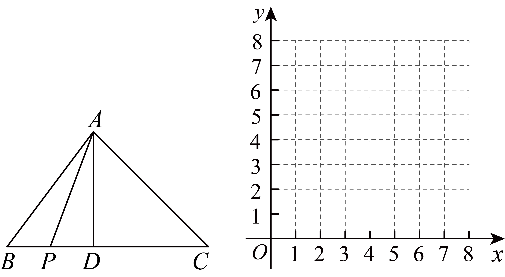

# Mathematics - 题目 2502

**ID**: 2c8b25dce5754bd88d9ec9a1bcfd54db
**年级**: Grade 9
**难度**: Medium
**题型**: Calculation

## 题目
如图，在 $\vartriangle ABC$ 中 $,AD$ 是 $BC$ 边上的高， $AD=CD=4,BD=3,P$ 是 $BC$ 上一动点（不与点 $B，C$ 重合），设 $BP$ 的长度为 $x,\vartriangle ABC$ 与 $\vartriangle ABP$ 的面积比为 $y{{}_{1}}$ ， $\mathrm{△}ADP$ 的面积为 $y{{}_{2}}$ ．（1）请直接写出 $y{{}_{1}},y{{}_{2}}$ 分别关于x的函数表达式，并注明自变量x的取值范围；​​​​​​​‌（2）在给定的平面直角坐标系中，画出函数 $y{{}_{1}},y{{}_{2}}$ 的图象，并分别写出函数 $y{{}_{1}},y{{}_{2}}$ 的一条性质；（3）结合函数图象，请直接写出 $y{{}_{1}}\geqslant y{{}_{2}}$ 时 $x$ 的取值范围．（近似值保留小数点后一位，误差不超过0．2）

## 解答

1. （1）解： $\vartriangle ABC$ 的面积为 $\frac {1}{2}BC\cdot AD=\frac {1}{2}\left ({BD+CD}\right )AD=\frac {1}{2}\mathrm{×}7\mathrm{×}4=14$ ；
2. $\vartriangle ABP$ 的面积为 $\frac {1}{2}BP\cdot AD=\frac {1}{2}x\mathrm{×}4=2x$ ，
3. 所以 $y{{}_{1}}=\frac {14}{2x}=\frac {7}{x}\left ({0<x<7}\right )$ ，即 $y{{}_{1}}=\frac {7}{x}(0<x<7)$ ；
4. 当点P在线段 $BD$ 上时，则 $PD=3-x$ ，
5. ∴ $\mathrm{△}ADP$ 的面积为： $\frac {1}{2}PD\cdot AD=\frac {1}{2}\left ({3-x}\right )\mathrm{×}4=-2x+6\left ({0\mathrm{<}x\mathrm{<}3}\right )$ ；
6. 当点P在线段 $CD$ 上时，则 $PD=x-3$ ，
7. ∴ $\mathrm{△}ADP$ 的面积为： $\frac {1}{2}PD\cdot AD=\frac {1}{2}\left ({x-3}\right )\mathrm{×}4=2x-6\left ({3\mathrm{<}x\mathrm{<}7}\right )$ ；
8. 综上， $y{{}_{2}}=\left \{{{}_{2x-6(3<x<7)}^{-2x+6(0<x<3)}}\right.$ ．
9. （2）解：画出函数 $y{{}_{1}},y{{}_{2}}$ 的图象如图，
10. 
11. 性质：① $y{{}_{1}}$ 随 $x$ 的增大而减小；
12. ②当 $0<x<3$ 时， $y{{}_{2}}$ 随 $x$ 的增大而减小，当 $3<x<7$ 时 $,y{{}_{2}}$ 随 $x$ 的增大而增大；(答案不唯一)
13. （3）解：∵ $y{{}_{1}}$ 的图象在 $y{{}_{2}}$ 的图象上方时x的取值范围大约为 $0<x\leqslant 3.9$ ．
14. ∴ $y{{}_{1}}\geqslant y{{}_{2}}$ 时 $x$ 的取值范围 $0<x\leqslant 3.9$ ．

## 知识点

**中文**:
  - 一次函数的图象和性质
  - 从函数的图象获取信息
  - 动点问题的函数图象
  - 反比例函数的性质

**English**:
  - Graphs and Properties of Linear Functions
  - Extracting Information from Graphs
  - Graphs of Moving Point Problems
  - Properties of Inverse Proportionality Functions

---
