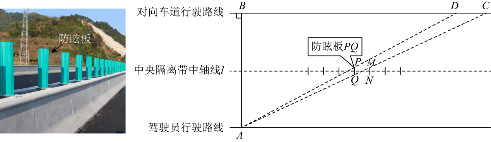

# Mathematics - 题目 3812

**ID**: 2d5ff0b42a0a4b5c9b1575397206e266
**年级**: Grade 9
**难度**: Medium
**题型**: Calculation

## 题目
综合与实践．【实践背景】夜间在高速公路上行车时，对向来车的灯光易引发眩光现象，进而导致交通事故，因此高速公路设置了防眩板遮挡对向车辆灯光．【数学建模】如图是一条高速公路的俯视示意图，中央隔离带的中轴线垂直平分每块防眩板，防眩板宽度是 $0.​​​​​​​‌2$ 米（ $PQ=MN=0.2$ 米）．一辆汽车车灯位于点 $\mathrm{A}$ 时，车灯发出的光线 $AC$ 分别经过防眩板 $PQ$ ， $MN$ 的点 $Q$ 和点 $M$ ，光线 $AD$ 经过防眩板 $PQ$ 的点 $P$ ， $AB\bot DC$ ，道路 $AB=8$ 米，光线 $AD$ 和行驶路线的夹角 $\angle BDA=11.4{}\degree $ ．（参考数据： $\sin 11.4{}\degree \approx 0.19$ ， ${\tan}11.4{}\degree \approx \frac {1}{5}$ ）【解决问题】(1) $BD$ 的长度是多少米？(2)防眩板 $PQ$ ， $MN$ 间的距离 $PM$ 是多少米？

## 解答

1. （1）解：（1）依题意，在 ${\rm{R}}{\rm{t}}△ABD$ 中，
2. ∵ ${\tan}\angle BDA=\frac {AB}{BD}$ ， $\angle BDA=11.4{}\degree $ ， ${\tan}11.4{}\degree \approx \frac {1}{5}$ ， $AB=8$ 米，
3. ∴ $\frac {1}{5}\approx \frac {8}{BD}$ ，
4. ∴ $BD\approx 40$ （米）．
5. 答： $BD$ 的长度约是 $40$ 米．
6. （2）解：如图，分别过点 $M$ ， $Q$ 作 $MH\bot AB$ 于点 $H$ ， $QG\bot AB$ 于点 $G$ ，
7. 
8. 依题意得 $AH=\frac {1}{2}AB+\frac {1}{2}PQ=\frac {8}{2}+\frac {0.2}{2}=4.1$ （米），
9. ∵ $HP\parallel BD$ ，
10. ∴ $\vartriangle AHP∽\vartriangle ABD$ ，
11. ∴ $\frac {AH}{AB}{\rm{=}}\frac {HP}{BD}$ ，
12. ∴ $\frac {4.1}{8}{\rm{=}}\frac {HP}{40}$ ，
13. ∴ $HP=20.5$ （米）．
14. 设 $PM=x$ 米，
15. ∵ $PQ\mathrm{/\mskip-4mu/}AH$ ，
16. ∴ $\vartriangle MPQ∽\vartriangle MHA$ ，
17. ∴ $\frac {MP}{MH}=\frac {PQ}{AH}$ ，
18. ∴ $\frac {x}{x+20.5}{\rm =}$  $\frac {0.2}{4.1}$ ，
19. 解得 ${\rm \mathit{x}=}\frac {41}{39}$ ，
20. 经检验 ${\rm \mathit{x}=}\frac {41}{39}$ 是原方程的解．
21. ∴防眩板 $PQ$ ， $MN$ 间的距离 $PM$ 是 $\frac {41}{39}$ 米．

## 知识点

**中文**:
  - 相似三角形的判定与性质综合
  - 解直角三角形
  - 解直角三角形的实际应用

**English**:
  - Determination and Properties
  - Solving Right Triangles
  - Applications of Solving Right Triangles

---
