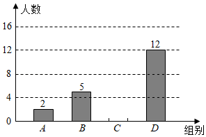

# Mathematics - 题目 3349

**ID**: 2f7a48c61f884dd29fce7bdee2c2c243
**年级**: Grade 9
**难度**: Medium
**题型**: Calculation

## 题目
为了解本校九年级学生的体质健康情况，李老师随机抽取35名学生进行了一次体质健康测试，根据测试成绩制成统计图表．组别分数段人数A$x<60$2B$60\leqslant x<75$5C$75\leqslant x<90$aD$x\geqslant 90$12请根据上述信息解答下列问题：（1）本次调查属于调查，样本容量是；​​​​​​​‌（2）表中的 $a=$，样本数据的中位数位于组；（3）补全条形统计图；（4）该校九年级学生有980人，估计该校九年级学生体质健康测试成绩在D组的有多少人？

## 解答

1. （1）本次调查属于抽样调查，样本的容量是35，
2. 故答案为：抽样，35；
3. （2） $a=35-2-5-12=16$ ，
4. 根据中位数的定义，样本数据的中位数位于C组，
5. 故答案为：16，C；
6. （3）由（2）得，C组的人数为 16，补全条形统计图如下：
7. 
8. （4）980 $\times \frac {12}{35}=336$ （人）．
9. 答：估计该校九年级学生体质健康测试成绩在D组的有336人．

## 知识点

**中文**:
  - 全面调查与抽样调查
  - 用样本估计总体
  - 条形统计图
  - 频数分布表

**English**:
  - Census and Sampling
  - Estimating Population from Sample
  - Bar Charts
  - Frequency Distribution Tables

---
