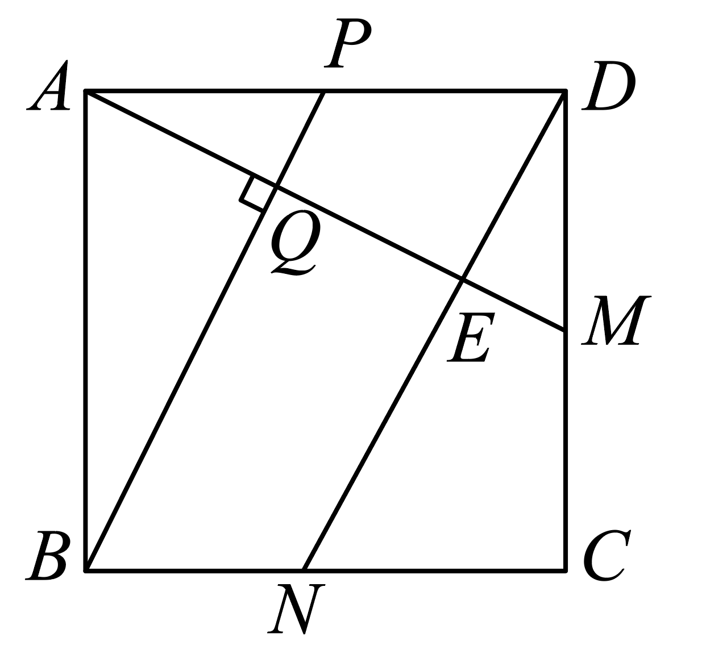

# Mathematics - 题目 3330

**ID**: 30af5195ab6f408f82328b8129f170c8
**年级**: Grade 9
**难度**: Medium
**题型**: Calculation

## 题目
在学习了平行四边形与正方形的相关知识后，智慧小组进行了更深入的探究．他们发现，如图所示的正方形 $ABCD$ ，分别取 $BC$ ， $CD$ 的中点 $M$ ， $N$ ，连接 $AM$ ， $DN$ 交于点 $E$ ，过 $B$ 作 $AM$ 的垂线，交 $AM$ 于点 $Q$ ，交 $AD$ 于点 $P$ ．则四边形 $BPDN$ 是平行四边形．（1）用尺规完成以下基本作图：过 $B$ 作 $AM$ 的垂线，交 $AM$ 于点 $Q$ ，交 $AD$ 于点 $P$ （只保留作图痕迹）．（2）根据（1）中所作图形，智慧小组发现四边形 $BPDN$ 是平行四边形成立，并给出了证明，请补全证明过程．证明：∵四边形 $ABCD$ 是正方形，∴ $AD=CD=BC$ ， $\angle ADC=\angle C=90{}\degree $ ， $AD\mathrm{/\mskip-4mu/}BC$ ．又∵ $M$ ， $N$ 分别为 $BC$ ， $CD$ 的中点，∴ $DM=\frac {1}{2}CD$ ， $CN=\frac {1}{2}BC$ ，∴_①_，在 $\vartriangle ADM$ 与 $\vartriangle DCN$ 中， $\begin{cases}AD=CD\\\angle ADM=\angle C\\DM=CN\end{cases}$∴ $\vartriangle ADM≌\vartriangle DCN\left ({SAS}\right )$ ．∴_②_．又∵ $\angle CDN+\angle ADN=90{}\degree $ ，∴ $\angle DAM+\angle ADN=90{}\degree $ ，∴ $\angle AED=90{}\degree $ ，又∵ $BP\bot AE$ ，∴ $\angle AQP=\angle AED=90{}\degree $ ，∴_③_．又∵ $DP/\mskip-4mu/BN$∴四边形 $BPDN$ 是平行四边形．进一步思考，智慧小组发现任取 $BC$ ， $CD$ 的上点 $N$ ， $M$ （ $M$ 不与 $C$ ， $D$ 重合）， $DM=CN$ ，连接 $AM$ ， $DN$ ，过 $B$ 作 $AM$ 的垂线，交 $AD$ 于点 $P$ ，则四边形 $BPDN$ 是_④_．​​​​​​​‌

## 解答

1. （1）解：如图所示， $BP$ 就是所求作的经过点B垂直于 $AM$ 于Q，交 $AD$ 于P的直线，
2. 
3. （2）证明：∵四边形 $ABCD$ 是正方形，
4. ∴ $AD=CD=BC$ ， $\angle ADC=\angle C=90{}\degree $ ， $AD\mathrm{/\mskip-4mu/}BC$ ．
5. 又∵ $M$ ， $N$ 分别为 $BC$ ， $CD$ 的中点，
6. ∴ $DM=\frac {1}{2}CD$ ， $CN=\frac {1}{2}BC$ ，
7. ∴ $DM=CN$ ，
8. 在 $\vartriangle ADM$ 与 $\vartriangle DCN$ 中， $\begin{cases}AD=CD\\\angle ADM=\angle C\\DM=CN\end{cases}$
9. ∴ $\vartriangle ADM≌\vartriangle DCN\left ({{\rm{S}}{\rm{A}}{\rm{S}}}\right )$ ．
10. ∴ $\angle DAM=\angle CDN$ ．
11. 又∵ $\angle CDN+\angle ADN=90{}\degree $ ，
12. ∴ $\angle DAM+\angle ADN=90{}\degree $ ，
13. ∴ $\angle AED=90{}\degree $ ，
14. 又∵ $BP\bot AE$ ，
15. ∴ $\angle AQP=\angle AED=90{}\degree $ ，
16. ∴ $BP{\rm{/\mskip-4mu/}}DN$ ．
17. 又∵ $DP{\rm{/\mskip-4mu/}}BN$
18. ∴四边形 $BPDN$ 是平行四边形．
19. 进一步思考：如图，
20. 
21. ∵四边形 $ABCD$ 是正方形，
22. ∴ $AD=CD=BC$ ， $\angle ADC=\angle C=90{}\degree $ ， $AD\mathrm{/\mskip-4mu/}BC$ ．
23. 在 $\vartriangle ADM$ 与 $\vartriangle DCN$ 中，
24. $\begin{cases}AD=CD\\\angle ADM=\angle C\\DM=CN\end{cases}$
25. ∴ $\vartriangle ADM≌\vartriangle DCN\left ({{\rm{S}}{\rm{A}}{\rm{S}}}\right )$ ．
26. ∴ $\angle DAM=\angle CDN$ ．
27. 又∵ $\angle CDN+\angle ADN=90{}\degree $ ，
28. ∴ $\angle DAM+\angle ADN=90{}\degree $ ，
29. ∴ $\angle AED=90{}\degree $ ，
30. 又∵ $BP\bot AE$ ，
31. ∴ $\angle AQP=\angle AED=90{}\degree $ ，
32. ∴ $BP{\rm{/\mskip-4mu/}}DN$ ．
33. 又∵ $DP{\rm{/\mskip-4mu/}}BN$
34. ∴四边形 $BPDN$ 是平行四边形．
35. 故答案为：平行四边形．

## 知识点

**中文**:
  - 四边形综合

**English**:
  - Comprehensive Quadrilateral Problems

---
