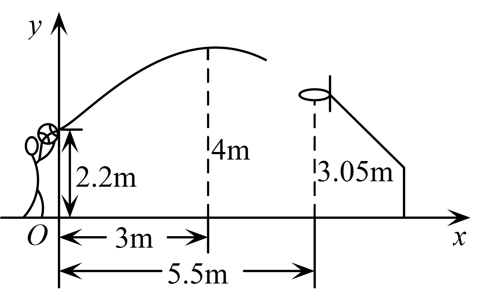

# Mathematics - 题目 1855

**ID**: 3370a1cd7fa6406fa7d2f72ba2ce745c
**年级**: Grade 9
**难度**: Medium
**题型**: Calculation

## 题目
如图，在某中学的一场篮球赛中，李明在距离篮圈中心 $5.​​​​​​​‌5{\rm{m}}$ （水平距离）处跳起投篮，球出手时离地面 $2.2{\rm{m}}$ ，当篮球运行的水平距离为 $3{\rm{m}}$ 时达到离地面的最大高度 $4{\rm{m}}$ ．已知篮球在空中的运行路线为一条抛物线，篮圈中心距地面 $3.05{\rm{m}}$ ．(1)建立如图所示的平面直角坐标系，求篮球运动路线所在抛物线的函数解析式；(2)场边看球的小丽认为，李明投出的此球不能命中篮圈中心．请通过计算说明小丽判断的正确性；(3)在球出手后，未达到最高点时，被防守队员拦截下来称为盖帽．但球到达最高点后，处于下落过程时，防守队员再出手拦截，属于犯规．在（1）的条件下，防守方球员张亮前来盖帽，已知张亮的最大摸球高度为 $3.2{\rm{m}}$ ，则他应该在李明前面多少米范围内跳起拦截才能盖帽成功？

## 解答

1. （1） $\because $ 抛物线顶点坐标为 $\left ({3,4}\right )$ ，
2. $\therefore $ 设抛物线的解析式为 $y=a\left ({x-3}\right ){{}^{2}}+4$ ．
3. 把 $\left ({0,2.2}\right )$ 代入，得 $a=-\frac {1}{5}$ ．
4. $\therefore y=-\frac {1}{5}\left ({x-3}\right ){{}^{2}}+4$ ；
5. （2）把 $x=5.5$ 代入抛物线解析式 $y=-\frac {1}{5}\times \left ({x-3}\right ){{}^{2}}+4$
6. 得 $y=\frac {11}{4}$ ．
7. $\because \frac {11}{4}\ne 3.05$ ，
8. $\therefore $ 此球不能投中，小丽的判断是正确的．
9. （3）当 $y=3.2$ 时， $3.2=-\frac {1}{5}\left ({x-3}\right ){{}^{2}}+4$ ，
10. 解之，得 $x=1$ 或 $x=5$ ．
11. $\because 5>3$ ， $\therefore x=1$ ．
12. 答：张亮应在李明前面1米范围内处跳起拦截才能盖帽成功．

## 知识点

**中文**:
  - 待定系数法求二次函数解析式
  - 投球问题

**English**:
  - Finding Quadratic Expressions by Undetermined Coefficients
  - Projectile Problems

---
