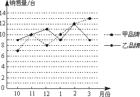

# Mathematics - 题目 1237

**ID**: 3da87a9bc24d433caefecf36e5336e7e
**年级**: Grade 9
**难度**: Medium
**题型**: Calculation

## 题目
作为一项惠农强农应对国际金融危机、拉动国内消费需求的重要措施，“家电下乡”工作已取得成效，在气温较低的季节，电冰箱也有一定的销量．我市某家电公司营销点对自去年10月份至今年3月份销售两种不同品牌冰箱的数量做出统计，数据如图所示：根据图提供的信息解答下列问题：（1）请你从平均数角度对这6个月甲、乙两品牌冰箱的销售量作出评价；​​​​​​​‌（2）请你从方差角度对这6个月甲、乙两品牌冰箱的销售情况作出评价；（3）请你依据折线图的变化趋势，对营销点今后的进货情况提出建议．

## 解答

1. 试题分析：（1）由平均数的计算公式进行计算；
2. （2）由方差的计算公式进行计算；
3. （3）依据折线图的变化趋势，对销售量呈上升趋势的冰箱，进货时可多进．
4. 试题解析：（1）甲品牌销售量的算平均数为10台，乙品牌销售量的算平均数也为10台，所以这6个月甲、乙两品牌冰箱的销售量相同；
5. （2）甲品牌销售量的方差是 $\frac {13}{3}$ ，乙品牌销售量的方差是 $\frac {4}{3}$ ；所以这6个月乙品牌冰箱的销售比甲品牌冰箱的销售稳定；
6. （3）建议如下：从折线图来看，甲品牌冰箱的月销售量呈上升趋势，进货时可多进甲品牌冰箱．
7. 考点：1.方差；2.折线统计图；3.算术平均数．

## 知识点

**中文**:
  - 折线统计图

**English**:
  - Line Charts

---
