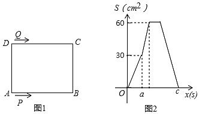

# Mathematics - 题目 3581

**ID**: 4099c38ecda441e6ad1bcfe89d248b0a
**年级**: Grade 9
**难度**: Medium
**题型**: Calculation

## 题目
如图1，在长方形ABCD中， $AB=12cm$ ， $BC=10cm$ ，点P从A出发，沿 $A\to B\to C\to D$ 的路线运动，到D停止；​​​​​​​‌点Q从D点出发，沿 $D\to C\to B\to A$ 路线运动，到A点停止．若P、Q两点同时出发，速度分别为每秒 $1cm$ 、 $2cm$ ，a秒时P、Q两点同时改变速度，分别变为每秒 $2cm$ 、 $\frac {5}{4}cm$ (P、Q两点速度改变后一直保持此速度，直到停止)，如图2是 $\Delta APD$ 的面积 $s(cm{^{2}})$ 和运动时间 $x$ (秒)的图象．(1)求出a值；(2)设点P已行的路程为 $y{{}_{1}}(cm)$ ，点Q还剩的路程为 $y{{}_{2}}(cm)$ ，请分别求出改变速度后， $y{{}_{1}},y{{}_{2}}$ 和运动时间 $x$ (秒)的关系式；(3)求P、Q两点都在BC边上，x为何值时P，Q两点相距3cm？

## 解答

1. （1）由图象可知，当点P在BC上运动时，△APD的面积保持不变，则a秒时，点P在AB上．
2. $\frac {1}{2}\times 10AP=30$ ，
3. ∴AP=6，
4. 则a=6；
5. （2）由（1）6秒后点P变速，则点P已行的路程为y_{1}=6+2（x﹣6）=2x﹣6，
6. ∵Q点路程总长为34cm，第6秒时已经走12cm，
7. 故点Q还剩的路程为y_{2}=34﹣12﹣ $\frac {5}{4}(x-6)=\frac {59}{2}-\frac {5}{4}x$ ；
8. （3）当P、Q两点相遇前相距3cm时，
9. $\frac {59}{2}-\frac {5}{4}x$ ﹣（2x﹣6）=3，解得x=10，
10. 当P、Q两点相遇后相距3cm时，
11. （2x﹣6）﹣（ $\frac {59}{2}-\frac {5}{4}x$ ）=3，解得x= $\frac {154}{13}$ ，
12. ∴当x=10或 $\frac {154}{13}$ 时，P、Q两点相距3cm

## 知识点

**中文**:
  - 四边形综合

**English**:
  - Comprehensive Quadrilateral Problems

---
