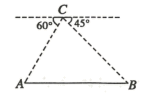

# Mathematics - 题目 3171

**ID**: 40e8dfa8e984449abcea037e6a71b57a
**年级**: Grade 9
**难度**: Medium
**题型**: Calculation

## 题目
某校“综合与实践”小组采用无人机辅助的方法测量一座桥的长度．如图，桥AB是水平并且笔直的，测量过程中，小组成员遥控无人机飞到桥AB的上方120米的点C处悬停，此时测得桥两端A，B两点的俯角分别为60°和45°，则桥AB的长度是米（结果保留根号）．​​​​​​​‌

## 解答

1. 如图示：过点C作CD⊥AB，垂足为D，
2. 
3. 由题意得，∠MCA=∠A=60°，∠NCB=∠B=45°，CD=120（米），
4. 在Rt△ACD中， $AD=\frac {CD}{{\tan}60{}^\circ }=\frac {120}{\sqrt {3}}=40\sqrt {3}$ （米），
5. 在Rt△BCD中，
6. ∵∠CBD=45°，
7. ∴BD=CD=120（米），
8. ∴AB=AD+BD=（ $40\sqrt {3}$ +120）（米）．
9. 答：桥AB的长度为（ $40\sqrt {3}$ +120）米．
10. 故答案是： $\left ({120+40\sqrt {3}}\right )$

## 知识点

**中文**:
  - 特殊角的三角函数值
  - 解直角三角形的实际应用

**English**:
  - Trigonometric Values of Special Angles
  - Applications of Solving Right Triangles

---
