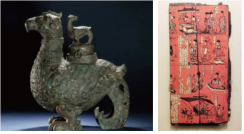

# Mathematics - 题目 2314

**ID**: 4248792b5b1f48dab208b2b0aa46bdef
**年级**: Grade 9
**难度**: Medium
**题型**: Calculation

## 题目
晋侯鸟尊作为山西博物馆的镇馆之宝，不仅是西周青铜艺术的杰作，更是见证大国沧桑的国之瑰宝．而木板漆画是山西博物馆的另一件镇馆之宝，填补了北魏前期绘画实物的空缺，在工艺、绘画和书法上有极高的历史和艺术价值．某商店计划购买一批仿制鸟尊工艺品和木板漆画工艺品，已知购买4件鸟尊工艺品和3件木板漆画工艺品需花费1068元，购买2件鸟尊工艺品和1件木板漆画工艺品需花费468元．(1)求鸟尊工艺品和木板漆画工艺品的单价；​​​​​​​‌(2)该商店计划购买鸟尊工艺品和木板漆画工艺品共100件，其中鸟尊工艺品的数量超过木板漆画工艺品数量的 $\frac {1}{3}$ ，当购买多少件鸟尊工艺品时，购买这批工艺品的总费用最低？最低总费用为多少元？

## 解答

1. （1）解：设鸟尊工艺品的单价为x元/件，木板漆画工艺品的单价为y元/件．根据题意，得
2. $\begin{cases}4x+3y=1068\\2x+y=468\end{cases}$ ，
3. 解得  $\begin{cases}x=168\\y=132\end{cases}$ ，
4. 答：鸟尊工艺品的单价为168元/件，木板漆画工艺品的单价为132元/件；
5. （2）解：设购买鸟尊工艺品m件．费用为w元．则
6. $w=168m+132(100-m)=36m+13200$ ，
7. ∵ $36>0$ ，
8. ∴w随m的增大而增大，
9. ∵ $m>\frac {1}{3}\left ({100-m}\right )$ ，
10. ∴ $m>25$ ，
11. ∴当 $m=26$ 时，w最小，最小值为 $36\times 26+13200=14136$ （元），
12. 答：当购买26件鸟尊工艺品时，购买这批工艺品的总费用最低，为14136元．

## 知识点

**中文**:
  - 分配方案问题
  - 分配问题

**English**:
  - Allocation Plan Problems
  - Distribution Problems

---
