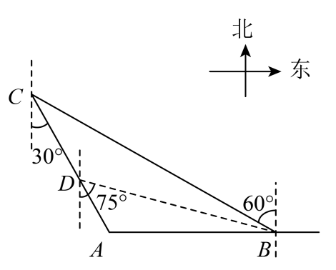

# Mathematics - 题目 1795

**ID**: 4324184cbf2544e0ab5c723e144e0d4c
**年级**: Grade 9
**难度**: Medium
**题型**: Calculation

## 题目
我国一艘巡航船在南海海域 $\mathrm{A}$ 处巡逻， $B$ 岛上的海军发现点 $\mathrm{A}$ 在点 $B$ 的正西方向， $C$ 岛上的海军发现点 $\mathrm{A}$ 在点 $C$ 的南偏东 $30{}\degree $ 的方向上，已知点 $C$ 在点 $B$ 的北偏西 $60{}\degree $ 方向上，且 $B$ 、 $C$ 两地相距120海里，如图所示．(1)求此时点 $\mathrm{A}$ 到 $C$ 岛的距离；​​​​​​​‌(2) $AC$ 上的 $D$ 处有一只渔船发出求救信号，希望 $\mathrm{A}$ 处的巡航船沿 $AC$ 方向在 $2$ 个小时赶到 $D$ 处进行救援，若巡航船以每小时 $15$ 海里／小时的速度能提前到达吗？已知在 $D$ 岛测得点 $B$ 在 $D$ 的南偏东 $75{}\degree $ 的方向上．（不计水流速度，结果保留根号）

## 解答

1. （1）解：过点 $C$ 作 $CE⊥AB$ ，则： $\angle BEC=\angle AEC=90{}\degree $ ，
2. 
3. 由题意，得： $\angle ACE=30{}\degree ,\angle CBE=90{}\degree -60{}\degree =30{}\degree $ ， $BC=120$ ，
4. 在 ${\rm{R}}{\rm{t}}\vartriangle BEC$ 中， $CE=BC\cdot \sin 30{}\degree =60$ ，
5. 在 ${\rm{R}}{\rm{t}}\mathrm{△}AEC$ 中， $AC=CE\div {\cos}30{}\degree =60\div \frac {\sqrt {3}}{2}=40\sqrt {3}$ ，
6. ∴点 $\mathrm{A}$ 到 $C$ 岛的距离为 $40\sqrt {3}$ 海里；
7. （2）过点 $D$ 作 $DF\bot AB,DH\bot BC$ ，设 $AD=x$ ，则： $CD=AC-AD=40\sqrt {3}-x$ ，
8. 
9. 由题意，得： $\angle BDF=75{}\degree ,\angle ADF=\angle ACE=30{}\degree $ ， $\angle ECB=60{}\degree $ ，
10. ∴ $\angle DBA=15{}\degree $ ，
11. ∴ $\angle CBD=\angle CBA-\angle ABD=15{}\degree $ ，
12. ∴ $BD$ 平分 $∠ABC$ ，
13. ∴ $DF=DH$ ，
14. 在 ${\rm{R}}{\rm{t}}△DAF$ 中， $DF=AD\cdot {\cos}30{}\degree =\frac {\sqrt {3}}{2}x$ ，
15. ∴ $DF=DH=\frac {\sqrt {3}}{2}x$ ，
16. 在 ${\rm{R}}{\rm{t}}\mathrm{△}DHC$ 中， $DH=CD\cdot \sin 30{}\degree $ ，
17. ∴ $\frac {\sqrt {3}}{2}x=\frac {1}{2}\left ({40\sqrt {3}-x}\right )$ ，
18. 解得： $x=60-20\sqrt {3}$ ，
19. ∴ $AD=60-20\sqrt {3}$ ，
20. ∵ $15\times 2=30>60-20\sqrt {3}\approx 25$ ，
21. ∴巡航船以每小时 $15$ 海里／小时的速度能提前到达．

## 知识点

**中文**:
  - 解直角三角形的实际应用

**English**:
  - Applications of Solving Right Triangles

---
