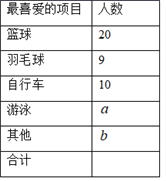
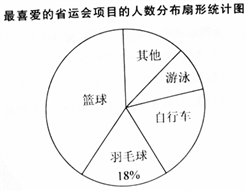

# Mathematics - 题目 547

**ID**: 44563b1d88f34959b3c6e16ea9521b4c
**年级**: Grade 9
**难度**: Medium
**题型**: Calculation

## 题目
江苏省第十九届运动会将于2018年9月在扬州举行开幕式，某校为了了解学生“最喜爱的省运会项目”的情况，随机抽取了部分学生进行问卷调查，规定每人从“篮球”、“羽毛球”、“自行车”、“游泳”和“其他”五个选项中必须选择且只能选择一个，并将调查结果绘制成如下两幅不完整的统计图表.​​​​​​​‌最喜爱的省运会项目的人数调查统计表根据以上信息，请回答下列问题：（1）这次调查的样本容量是， $a+b=$；（2）扇形统计图中“自行车”对应的扇形的圆心角为度；（3）若该校有1200名学生，估计该校最喜爱的省运会项目是篮球的学生人数.

## 解答

1. 分析：（1）依据9÷18%，即可得到样本容量，进而得到a+b的值；
2. （2）利用圆心角计算公式，即可得到“自行车”对应的扇形的圆心角；
3. （3）依据最喜爱的省运会项目是篮球的学生所占的比例，即可估计该校最喜爱的省运会项目是篮球的学生人数．
4. 详解：（1）样本容量是9÷18%=50，
5. a+b=50-20-9-10=11，
6. 故答案为50，11；
7. （2）“自行车”对应的扇形的圆心角= $\frac {10}{50}$ ×360°=72°，
8. 故答案为72°；
9. （3）该校最喜爱的省运会项目是篮球的学生人数为：1200× $\frac {20}{50}$ =480（人）．

## 知识点

**中文**:
  - 圆心角与圆周角
  - 用样本估计总体
  - 条形统计图
  - 扇形统计图

**English**:
  - Central and Inscribed Angles
  - Estimating Population from Sample
  - Bar Charts
  - Pie Charts

---
