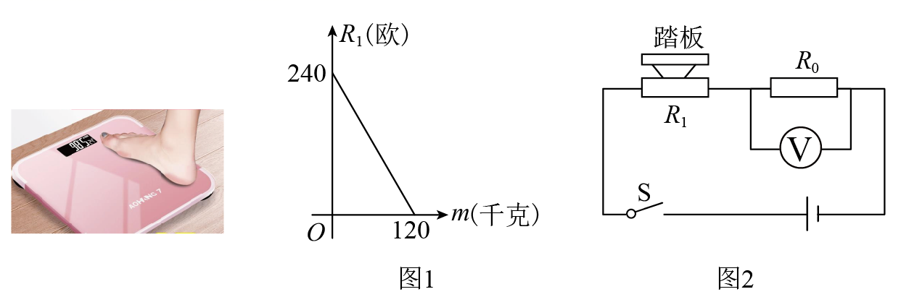

# Mathematics - 题目 2574

**ID**: 474f46795e104695a507d0a10d31c29b
**年级**: Grade 9
**难度**: Medium
**题型**: Calculation

## 题目
电子体重科读数直观又便于携带，为人们带来了方便．某综合实践活动小组设计了简易电子体重秤：制作一个装有踏板（踏板质量忽略不计）的可变电阻R_{1}，R_{1}与踏板上人的质量m之间的函数关系式为R_{1}＝km＋b（其中k，b为常数，0⩽m⩽120），其图象如图1所示；​​​​​​​‌图2的电路中，电源电压恒为8伏，定值电阻R0的阻值为30欧，接通开关，人站上踏板，电压表显示的读数为U0 ，该读数可以换算为人的质量m，温馨提示：①导体两端的电压U，导体的电阻R，通过导体的电流I，满足关系式I＝ $\frac {U}{R}$ ；②串联电路中电流处处相等，各电阻两端的电压之和等于总电压．（1）求k，b的值；（2）求R_{1}关于U_{0}的函数解析式；（3）用含U_{0}的代数式表示m；（4）若电压表量程为0~6伏，为保护电压表，请确定该电子体重秤可称的最大质量．

## 解答

1. 解：（1）把（0，240），（120，0）代入R_{1}＝km＋b，得 $\begin{cases}240=b\\0=120k+b\end{cases}$ ，解得： $\begin{cases}b=240\\k=-2\end{cases}$ ；
2. （2）∵ $\frac {U{{}_{0}}}{30}=\frac {8-U{{}_{0}}}{R{{}_{1}}}$ ，
3. ∴ $R{{}_{1}}=\frac {240}{U{{}_{0}}}-30$ ；
4. （3）由（1）可知： $\begin{cases}b=240\\k=-2\end{cases}$ ，
5. ∴R_{1}＝ $-2$m＋240，
6. 又∵ $R{{}_{1}}=\frac {240}{U{{}_{0}}}-30$ ，
7. ∴ $\frac {240}{U{{}_{0}}}-30$ = $-2$m＋240，即： $m=135-\frac {120}{U{{}_{0}}}$ ；
8. （4）∵电压表量程为0~6伏，
9. ∴当 $U{{}_{0}}=6$ 时， $m=135-\frac {120}{6}=115$
10. 答：该电子体重秤可称的最大质量为115千克．

## 知识点

**中文**:
  - 其他问题
  - 反比例函数的应用
  - 待定系数法求一次函数解析式

**English**:
  - Other Problems
  - Applications of Inverse Proportionality
  - Finding Expressions by Undetermined Coefficients

---
