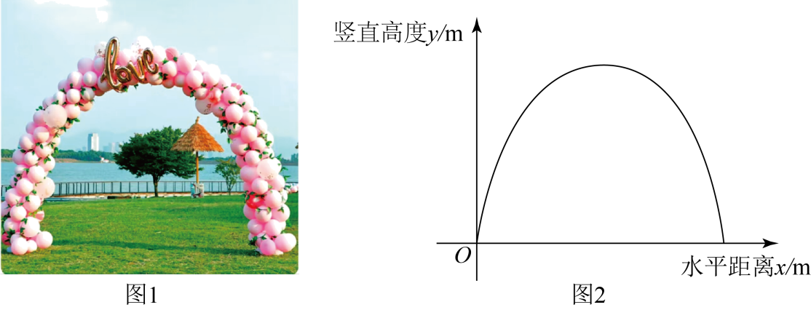

# Mathematics - 题目 3680

**ID**: 48f6ef4650dc4816b4b927d0da58546d
**年级**: Grade 9
**难度**: Medium
**题型**: Calculation

## 题目
如图1，某公园在入园处搭建了一道“气球拱门”，拱门两端落在地面上．若将拱门看作抛物线的一部分，建立如图2所示的平面直角坐标系．拱门上的点距地面的竖直高度 $y$ （单位： ${\rm{m}}$ ）与水平距离 $x$ （单位： ${\rm{m}}$ ）近似满足函数关系 $y=a(x-h){^{2}}+k(a<0)$ ．(1)拱门上的点的水平距离 $x$ 与竖直高度 $y$ 的几组数据如下：水平距离 $x/{\rm{m}}$23681012竖直高度 $y/{\rm{m}}$45.​​​​​​​‌47.26.440根据上述数据，直接写出“门高”（拱门的最高点到地面的距离），并求出拱门上的点满足的函数关系 $y=a(x-h){^{2}}+k(a<0)$ ．(2)一段时间后，公园重新维修拱门．新拱门上的点距地面的竖直高度 $y$ （单位： ${\rm{m}}$ ）与水平距离 $x$ （单位： ${\rm{m}}$ ）近似满足函数关系 $y=-0.288(x-5){^{2}}+7.2$ ，若记“原拱门”的跨度（跨度为拱门底部两个端点间的距离）为 $d{{}_{1}}$ ，“新拱门”的跨度为 $d{{}_{2}}$ ，则 $d{{}_{1}}$$d{{}_{2}}($ 填“ $>$ ”、“ $=$ ”或“ $<$ ”）．

## 解答

1. （1）解：由表格得：
2. $\because 6-2=10-6$ ，
3. $\therefore $ 顶点坐标为 $\left ({6,7.2}\right )$ ，
4. $\therefore y=a(x-6){^{2}}+7.2$ ，
5. $\therefore a(2-6){^{2}}+7.2=4$ ，
6. 解得： $a=-0.2$ ，
7. $\therefore y=-0.2(x-6){^{2}}+7.2$ ．
8. （2）解：由表格得
9. 当 $x=12$ 时， $y=0$ ，
10. 原拱门中： $d{{}_{1}}=12$ （ $m$ ）；
11. 新拱门中：
12. 当 $y=0$ 时，
13. $-0.288(x-5){^{2}}+7.2=0$
14. 解得： $x{{}_{1}}=0$ ， $x{{}_{2}}=10$ ，
15. $\therefore d{{}_{2}}=x{{}_{2}}-x{{}_{1}}=10$ （ ${\rm{m}}$ ），
16. $\because 12>10$ ，
17. $\therefore d{{}_{1}}>d{{}_{2}}$ ．
18. 故答案： $>$ ．

## 知识点

**中文**:
  - 拱桥问题

**English**:
  - Arch Bridge Problems

---
