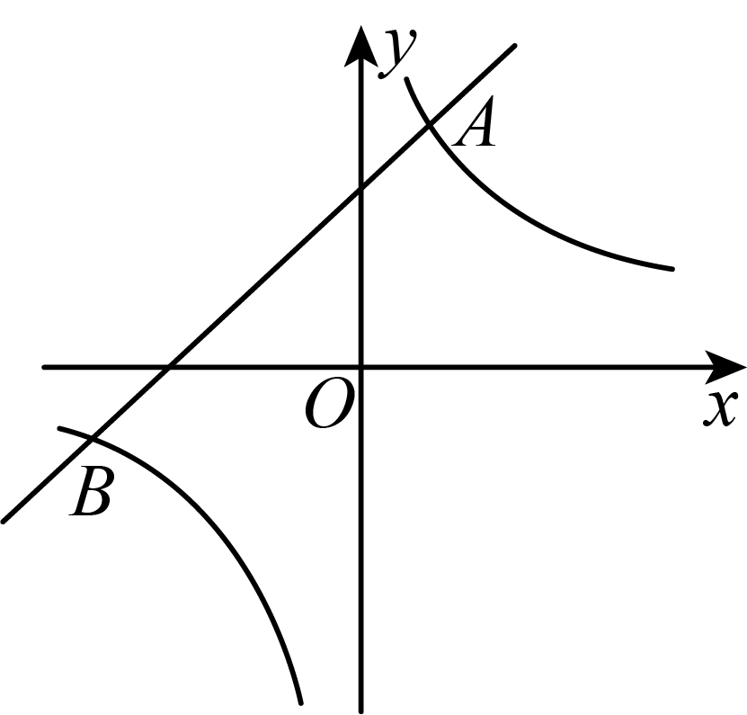

# Mathematics - 题目 240

**ID**: 4e0da18ece724b20af0762b4c924dc67
**年级**: Grade 9
**难度**: Medium
**题型**: Calculation

## 题目
如图，一次函数 $y=ax+b\left ({a\ne 0}\right )$ 的图像与反比例函数 $y=\frac {k}{x}\left ({k\ne 0}\right )$ 的图像交于点 $A\left ({1,4}\right )，B\left ({n,-1}\right )$ ．(1)求反比例函数和一次函数的表达式；​​​​​​​‌(2)利用图像，直接写出不等式 $ax+b<\frac {k}{x}$ 的解集；(3)已知点 ${\rm \mathit{D}}$ 在 ${\rm \mathit{x}}$ 轴上，点 ${\rm \mathit{C}}$ 在反比例函数图像上．若以 ${\rm \mathit{A}，\mathit{B}，\mathit{C}，\mathit{D}}$ 为顶点的四边形是平行四边形，求点 ${\rm \mathit{C}}$ 的坐标．

## 解答

1. （1）解∶∵ $y=\frac {k}{x}\left ({k\ne 0}\right )$ 经过 $A\left ({1,4}\right ){\rm ，}$
2. ∴ $4=\frac {k}{1}{\rm ，}$ 解得 $k=4{\rm ，}$
3. ∴ $y=\frac {4}{x}{\rm ，}$
4. 把 $B\left ({n,-1}\right )$ 代入 $y=\frac {4}{x}{\rm ，}$ 得 $-1=\frac {4}{n}{\rm ，}$
5. 解得 $n=-4{\rm ，}$
6. ∴ $B\left ({-4,-1}\right ){\rm ，}$
7. 把 $A\left ({1,4}\right ){\rm ，}$  $B\left ({-4,-1}\right )$ 代入 $y=ax+b\left ({a\ne 0}\right ){\rm ，}$
8. 得 $\begin{cases}a+b=4\\-4a+b=-1\end{cases}{\rm ，}$
9. 解得 $\begin{cases}a=1\\b=3\end{cases}{\rm ，}$
10. ∴ $y=x+3$ .
11. （2）解：观察图像得当 $x{\rm{<}}-{{4}}$ 或 $0<x<1$ 时，一次函数的图像在反比例函数图像的下方，
12. ∴不等式 $ax+b<\frac {k}{x}$ 的解集为 $x{\rm{<}}-{{4}}$ 或 $0<x<1$ .
13. （3）解：设点 ${\rm \mathit{C}}$ 的坐标为 $\left ({c,\frac {4}{c}}\right ){\rm ，}$  $D\left ({d,0}\right ){\rm ，}$
14. ①以 $AC{\rm ,}$  $BD$ 为对角线，
15. 则 $\begin{cases}1+c=-4+d\\4+\frac {4}{c}=-1+0\end{cases}{\rm ，}$
16. 解得 $\begin{cases}c=-\frac {4}{5}\\d=\frac {21}{5}\end{cases}{\rm ，}$
17. ∴ $\frac {4}{c}=-5{\rm ，}$
18. ∴ $C\left ({-\frac {4}{5},-5}\right )$ ；
19. ②以 $BC{\rm ,}$  $AD$ 为对角线，
20. 则 $\begin{cases}-4+c=1+d\\-1+\frac {4}{c}=4+0\end{cases}{\rm ，}$
21. 解得 $\begin{cases}c=\frac {4}{5}\\d=-\frac {21}{5}\end{cases}{\rm ，}$
22. ∴ $\frac {4}{c}=5{\rm ，}$
23. ∴ $C\left ({\frac {4}{5},5}\right )$ ；
24. ③以 $AB{\rm ,}$  $CD$ 为对角线
25. 则 $\begin{cases}1-4=c+d\\4-1=\frac {4}{c}+0\end{cases}{\rm ，}$
26. 解得 $\begin{cases}c=\frac {4}{3}\\d=-\frac {13}{3}\end{cases}{\rm ，}$
27. ∴ $\frac {4}{c}=3{\rm ，}$
28. ∴ $C\left ({\frac {4}{3},3}\right )$ .
29. 综上，当 ${\rm \mathit{C}}$ 的坐标为 $\left ({-\frac {4}{5},-5}\right )$ 或 $\left ({\frac {4}{5},5}\right )$ 或 $\left ({\frac {4}{3},3}\right )$ 时，以 ${\rm \mathit{A},\mathit{B},\mathit{C},\mathit{D}}$ 为顶点的四边形是平行四边形．

## 知识点

**中文**:
  - 一次函数的图象和性质
  - 反比例函数的图象
  - 反比例函数的性质
  - 平行四边形的判定与性质

**English**:
  - Graphs and Properties of Linear Functions
  - Graph of Inverse Proportionality Functions
  - Properties of Inverse Proportionality Functions
  - Determination and Properties

---
