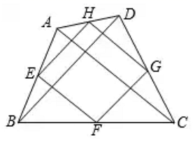

# Mathematics - 题目 2939

**ID**: 5080141fe4a14072a29ae4d797b8342e
**年级**: Grade 9
**难度**: Medium
**题型**: Calculation

## 题目
如图，在四边形 $ABCD$ 中， $E$ 、 $F$ 、 $G$ 、 $H$ 分别是 $AB$ 、 $BC$ 、 $CD$ 、 $DA$ 的中点，且 $AC\bot BD$ ．求证：四边形 $EFGH$ 是矩形．​​​​​​​‌

## 解答

1. 证明：∵点E、F、G、H分别是边AB、BC、CD、DA的中点，
2. ∴EF= $\frac {1}{2}$  AC，GH= $\frac {1}{2}$ AC，
3. ∴EF=GH，同理EH=FG
4. ∴四边形EFGH是平行四边形；
5. 又∵对角线AC、BD互相垂直，
6. ∴EF与FG垂直．
7. ∴四边形EFGH是矩形．

## 知识点

**中文**:
  - 中点四边形
  - 矩形的判定

**English**:
  - Midpoint Quadrilaterals
  - Determination of Rectangles

---
