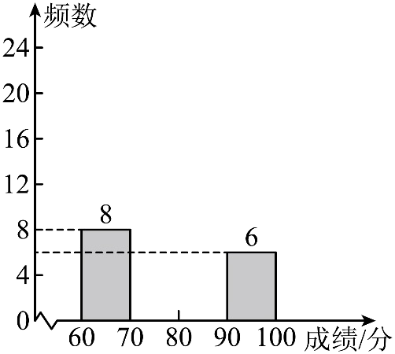

# Mathematics - 题目 2441

**ID**: 528dc15c812447fda972422b457932e5
**年级**: Grade 9
**难度**: Medium
**题型**: Calculation

## 题目
$2025$ 年横空出世的 $\mathrm{D}\mathrm{e}\mathrm{e}\mathrm{p}\mathrm{S}\mathrm{e}\mathrm{e}\mathrm{k}$ 可以在多个方面帮助中小学生提高能力，通过人机互动，学生可以学会如何提出问题、分析信息和评估答案，从而培养批判性思维能力，意义非凡．某校对学生进行了 $\mathrm{D}\mathrm{e}\mathrm{e}\mathrm{p}\mathrm{S}\mathrm{e}\mathrm{e}\mathrm{k}$ 的相关培训，并对培训效果进行了检测，并随机抽取了若干名同学的成绩，形成了如下的调查报告，请根据调查报告，回答下列问题：课题××学校学生对 $\mathrm{D}\mathrm{e}\mathrm{e}\mathrm{p}\mathrm{S}\mathrm{e}\mathrm{e}\mathrm{k}$ 掌握情况调查方式抽样调查调查对象××学校学生数据的整理与描述分组成绩 $x$ /分频数频率$A$$60\leqslant x<70$$8$$0.​​​​​​​‌16$$B$$70\leqslant x<80$$m$$0.24$$C$$80\leqslant x<90$$n$$0.48$$D$$90\leqslant x<100$$6$$p$调查结论…(1)上述表格中， $m=$， $n=$， $p=$；(2)所抽取学生成绩的中位数落在组；补全频数分布直方图；(3)若该校有 $1200$ 名学生参加了此次检测活动，请你估计成绩不低于 $80$ 分的学生有多少名？

## 解答

1. （1）解：由数据可知，抽取的学生人数为 $8\div 0.16=50$ ，
2. ∴ $m=50\times 0.24=12$ ， $n=50\times 0.48=24$ ， $p=\frac {6}{50}=0.12$ ，
3. 故答案为 $12$ ， $24$ ， $0.12$ ；
4. （2）解：∵抽取了 $50$ 名学生，
5. ∴学生成绩的中位数由低到高为第 $25$ 名和第 $26$ 名学生成绩的平均数，
6. ∴中位数落在组 $C$ ，
7. 故答案为 $C$ ；
8. 补全频数分布直方图如下：
9. 
10. （3）解： $1200\times \left ({0.48+0.12}\right )=720$ ，
11. 答：估计成绩不低于 $80$ 分的学生有 $720$ 人．

## 知识点

**中文**:
  - 用样本估计总体
  - 频数分布表
  - 频数分布直方图

**English**:
  - Estimating Population from Sample
  - Frequency Distribution Tables
  - Frequency Histograms

---
