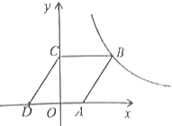

# Mathematics - 题目 1859

**ID**: 54b6ffc26ff34ecdb9e956d4a619a7ba
**年级**: Grade 9
**难度**: Medium
**题型**: Calculation

## 题目
如图，在平面直角坐标系中，点O为坐标原点，菱形ABCD的顶点A在x轴的正半轴上，菱形ABCD的边长为2，顶点C的坐标为 $\left ({0，\sqrt {3}}\right )$ ．(1)求图象过点B的反比例函数的解析式；​​​​​​​‌(2)求图象过点A，B的一次函数的解析式；(3)在第一象限内，当以上所求一次函数的图象在所求反比例函数的图象下方时，请直接写出自变量x的取值范围．

## 解答

1. （1）∵四边形ABCD是菱形，边长为2，C的坐标为 $\left ({0，\sqrt {3}}\right )$ ，
2. ∴ ${\rm{B}}{\rm{C}}={\rm{D}}{\rm{C}}={\rm{D}}{\rm{A}}=2$ ， ${\rm{B}}{\rm{C}}//{\rm{x}}轴$ ，点B的纵坐标为 $\sqrt {3}$
3. ∴ ${\rm{B}}\left ({2，\sqrt {3}}\right )$
4. 设反比例函数解析式为 ${\rm{y}}=\frac {{\rm{k}}}{{\rm{x}}}$ ，把B坐标代入得： ${\rm{k}}=2\sqrt {3}$ ，
5. 则反比例解析式为 ${\rm{y}}=\frac {2\sqrt {3}}{{\rm{x}}}$
6. （2）设直线AB解析式为 ${\rm{y}}={\rm{m}}{\rm{x}}+{\rm{n}}$ ，
7. ∵C的坐标为 $\left ({0，\sqrt {3}}\right )$ ， ${\rm{C}}{\rm{D}}=2$
8. ∴ ${\rm{O}}{\rm{D}}=1$ ，
9. ∴ ${\rm{O}}{\rm{A}}={\rm{A}}{\rm{D}}-{\rm{O}}{\rm{D}}=2-1=1$ ，
10. ∴A点坐标为（1，0），
11. 把 ${\rm{A}}\left ({1，0}\right )$ ， ${\rm{B}}（2，\sqrt {3}）$ 代入得： $\begin{cases}m+n=0\\2m+n=\sqrt {3}\end{cases}$ ，
12. 解得： $\begin{cases}m=\sqrt {3}\\n=-\sqrt {3}\end{cases}$ ，
13. ∴直线AB解析式为 ${\rm{y}}=\sqrt {3}{\rm{x}}-\sqrt {3}$ .
14. （3）在第一象限内当一次函数的图像在反比例函数的图像下方时，自变量x的取值范围为 $1＜{\rm{x}}＜2$

## 知识点

**中文**:
  - 反比例函数综合

**English**:
  - Comprehensive Inverse Proportionality Problems

---
