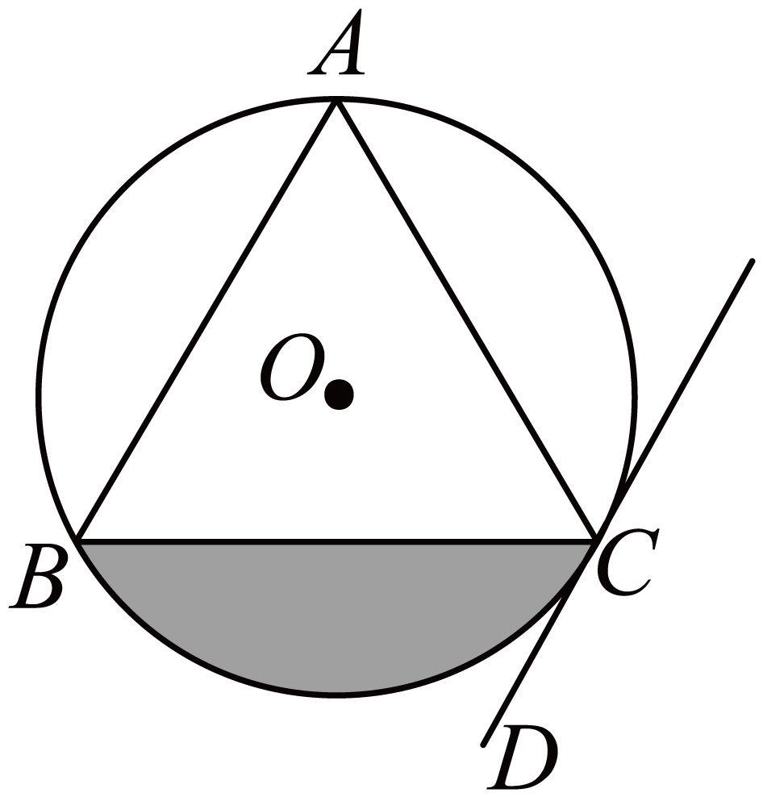

# Mathematics - 题目 534

**ID**: 551674091b9f4f45939390110a4ad4c5
**年级**: Grade 9
**难度**: Medium
**题型**: Calculation

## 题目
如图， $\odot O$ 为正三角形 $ABC$ 的外接圆，直线 $CD$ 经过点 ${\rm \mathit{C}，}CD{\rm{/\mskip-4mu/}}AB$ ．（1）判断直线 $CD$ 与 $\odot O$ 的位置关系，并说明理由；​​​​​​​‌（2）若圆的半径为2，求图中阴影部分的面积．

## 解答

1. （1）解：直线 $CD$ 与 $\odot O$ 相切，理由如下：
2. 如图，连接 $OC$ ，
3. 
4. $\because $  $\vartriangle ABC$ 是正三角形，
5. $\therefore $  $\angle A=\angle ACB=\angle ABC=60{}\degree $ ，
6. $\because $  $O$ 为正三角形 $ABC$ 的外接圆的圆心，
7. $\therefore $  $OC$ 平分 $∠ACB$ ，
8. $\therefore $  $\angle OCB=\frac {1}{2}\angle ACB=30{}\degree $ ，
9. $\because $  $CD{\rm{/\mskip-4mu/}}AB$ ，
10. $\therefore $  $\angle BCD=\angle ABC=60{}\degree $ ，
11. $\therefore $  $\angle OCD=\angle OCB+\angle BCD=30{}\degree +60{}\degree =90{}\degree $ ，
12. $\because $  $OC$ 是半径，
13. $\therefore $ 直线 $CD$ 与 $\odot O$ 相切；
14. （2）解：如图，连接 $OB$ ，作 $OH\bot BC$ 于点H，
15. 
16. $\because $  $\angle A=60{}\degree $ ，
17. $\therefore $  $\angle BOC=2\angle A=120{}\degree $ ，
18. $\therefore $  $S{{}_{扇形BOC}}=\frac {120{\rm{π}}\cdot OC{^{2}}}{360}=\frac {120{\rm{π}}\times 2{^{2}}}{360}=\frac {4}{3}{\rm{π}}$ ．
19. $\because $  $OH⊥BC$ ， $\angle OCB=30{}\degree $ ，
20. $\therefore $  $OH=\frac {1}{2}OC=1$ ， $BC=2CH$ ，
21. $\therefore $  $CH=\sqrt {OC{^{2}}-OH{^{2}}}=\sqrt {2{^{2}}-1{^{2}}}=\sqrt {3}$ ，
22. $\therefore $  $BC=2CH=2\sqrt {3}$ ，
23. $\therefore $  $S{{}_{\vartriangle OBC}}=\frac {1}{2}BC\cdot OH=\frac {1}{2}\times 2\sqrt {3}\times 1=\sqrt {3}$ ，
24. $\therefore $ 图中阴影部分的面积为 $S{{}_{扇形BOC}}-S{{}_{\vartriangle OBC}}=\frac {4}{3}{\rm{π}}-\sqrt {3}$ ．

## 知识点

**中文**:
  - 切线的判定定理
  - 扇形面积的计算
  - 圆周角定理

**English**:
  - Tangent Determination Theorem
  - Sector Area Calculation
  - Inscribed Angle Theorem

---
