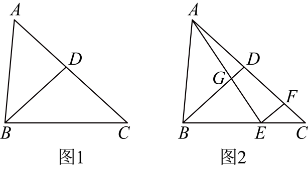

# Mathematics - 题目 574

**ID**: 56e72e28bef841c7bcba0a7cde9c7468
**年级**: Grade 9
**难度**: Medium
**题型**: Calculation

## 题目
如图1，在 $\vartriangle ABC$ 中， $BD$ 平分 $\angle ABC，BD=CD，AB=4，AC=6$ ．(1)求 $CD$ 的长；​​​​​​​‌(2)如图2，在（1）的条件下，E为 $BC$ 上的点，作 $\angle AEF=\angle ABC$ 交 $AC$ 于点 $F，AE、BD$ 相交于点G．①求证： $\mathrm{△}ABG\mathrm{∽}\mathrm{△}ECF$ ；②若 $BG=2CF$ ，求 $\frac {BG}{DG}$ ．

## 解答

1. （1）解：∵ $BD$ 平分 $\angle ABC,$
2. ∴ $\angle ABD=\angle CBD$ ，
3. ∵ $BD=CD$ ，
4. ∴ $\angle C=\angle CBD$ ，
5. ∴ $\angle ABD=\angle C$ ,
6. ∵ $\angle A=\angle A$ ，
7. ∴ $\mathrm{△}ABD∽\mathrm{△}ACB$ ，
8. ∴ $\frac {AD}{AB}=\frac {AB}{AC}$ ，
9. ∴ $AD=\frac {AB{^{2}}}{AC}=\frac {4{^{2}}}{6}=\frac {8}{3}$ ，
10. ∴ $CD=AC-AD=6-\frac {8}{3}=\frac {10}{3}$ ；
11. （2）①证明：∵ $\angle AEF=\angle ABC$ ， $\angle AEF+\angle CEF=\angle AEC=\angle ABC+\angle BAG$ ，
12. ∴ $\angle CEF=\angle BAG$ ，
13. 由（1）可知，  $\angle ABD=\angle C$ ，
14. ∴ $\mathrm{△}ABG\mathrm{∽}\mathrm{△}ECF$ ；
15. ②∵ $\mathrm{△}ABG\mathrm{∽}\mathrm{△}ECF$ ，
16. ∴ $\frac {AB}{EC}=\frac {BG}{FC}$ ，
17. ∵ $BG=2CF$ ，
18. ∴ $EC=\frac {1}{2}AB=2$ ，
19. 由已知及（1）可知， $BD=CD=\frac {10}{3}$ ， $\mathrm{△}ABD∽\mathrm{△}ACB$
20. ∴ $\frac {BD}{CB}=\frac {AB}{AC}$ ，
21. ∴ $BC=\frac {AC\cdot BD}{AB}=\frac {6\times \frac {10}{3}}{4}=5$ ，
22. ∴ $BE=BC-CE=3$ ，
23. 过点D作 $DM/\mskip-4mu/BC$ 交 $AE$ 于点M，如图，
24. 
25. ∴ $\angle ADM=\angle ACE，\angle AMD=\angle AEC$ ， $\angle BEG=\angle DMG，\angle GBE=\angle MDG$ ，
26. ∴ $\vartriangle ADM∽\vartriangle ACE，\vartriangle BEG∽\vartriangle DMG$ ，
27. ∴ $\frac {DM}{CE}=\frac {AD}{AC}，\frac {BG}{DG}=\frac {BE}{DM}$ ，
28. ∴ $DM=\frac {AD\cdot CE}{AC}=\frac {\frac {8}{3}\times 2}{6}=\frac {8}{9}$ ，
29. ∴ $\frac {BG}{DG}=\frac {BE}{DM}=\frac {3}{\frac {8}{9}}=\frac {27}{8}$ ．

## 知识点

**中文**:
  - 三角形的角平分线
  - 两直线平行内错角相等
  - 相似三角形的判定与性质综合

**English**:
  - Angle Bisectors
  - Parallel Lines have Equal Alternate Interior Angles
  - Determination and Properties

---
